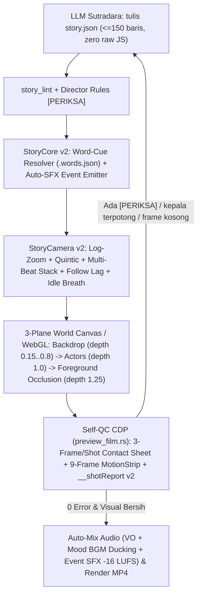

# Blueprint Pematangan Skill & Mesin Kamera Studio Aetheria
*(Studi Banding Arsitektur `stikman-cerita` vs Runtime `story-core.js` / `story-camera.js` / `.aetheria/skills/mg-*`)*

Dokumen ini merumuskan **akar masalah teknis** mengapa hasil video skill deklaratif Aetheria saat ini belum sehidup, sehalus, dan serapi hasil `stikman-cerita`, serta **rencana arsitektur konkret (Tahap A–E)** agar seluruh skill Studio Aetheria mencapai (dan melampaui) standar tersebut di atas mesin GPU HTML5 Canvas2D / WebGL2 kita.

---

## 1. Diagnosa Jujur: 6 Alasan Hasil Kita Belum Sebagus `stikman-cerita`

Setelah membedah kode sumber kita ([`story-core.js`](../apps/public/script/story-core.js), [`story-camera.js`](../apps/public/script/story-camera.js), [`clay-assets.js`](../.aetheria/skills/mg-soft-clay-story/examples/script/clay-assets.js), [`preview_film.rs`](../core/aetheria-engine/src/tool/preview_film.rs)) bersebelahan dengan `stikman-cerita` (`stik.py`, `adegan.py`, `tokoh.py`, `dunia.py`, `render.py`, `audio.py`), ditemukan **6 jurang arsitektur nyata**:

### Gap 1 — Kamera 2D kita me-zoom "1 Gambar Datar", bukan Dunia Berlapis (*World-Space Parallax*)
- **Kondisi Aetheria sekarang ([`story-core.js` L321–324](../apps/public/script/story-core.js#L321-L324)):** `StoryCamera.apply2D(ctx, camRes.rig, W, H)` men-transform seluruh kanvas 2D sekaligus. Akibatnya langit, latar jauh, karakter, dan meja bergeser dengan kecepatan identik seperti kertas datar yang di-zoom, dan batas aman dikunci ketat (`maxZoom: 1.32`, `maxPan: 0.08` di [`story-core.js` L311](../apps/public/script/story-core.js#L311)) supaya pinggir kanvas tidak bocor hitam.
- **Standar `stikman-cerita`:** Dunia digambar lebar (`X: -3200..+3200`) dengan proyeksi per-lapisan `depth` (`0.15` langit/matahari → `0.45` bukit → `0.8` pohon → `1.0` aktor → `1.25` semak depan). Kamera bebas melakukan *extreme close-up* `z = 3.4..5.2` (mis. insert jam weker `07:00`) lalu mundur ke `z = 0.86` tanpa pernah bocor tepi dan otomatis menghasilkan kedalaman ruang 2.5D.

### Gap 2 — Kamera kita "1 Shot = 1 Gerak RNG Acak", bukan Koreografi Sutradara Berlapis (`camera.moves[]`)
- **Kondisi Aetheria sekarang ([`story-camera.js` L444–485](../apps/public/script/story-camera.js#L444-L485)):**
  1. Jika penulis `story.json` tidak menulis `cameraStyle`, kamera **mati total** (`active: false`, 0 gerakan).
  2. Jika aktif, `planStoryMoves` mengundi **1 gerakan acak** sepanjang shot menggunakan interpolasi zoom linear `1 / (1 + dollyOff)` dan kurva `easeOutCubic` (`C¹`, percepatan patah di awal).
  3. Tidak bisa menumpuk beberapa beat kamera di dalam satu adegan.
- **Standar `stikman-cerita`:**
  1. **Zoom di Log-Space + *Fly-To Dip* (`terbang`):** `z = exp(lerp(log(z0), log(z1), q) - dip * sin(pi * q))` → kecepatan optik konstan seperti lensa sinema, otomatis *pull-out* di tengah terbang antar dua objek jauh.
  2. **Easing Default Quintic Smootherstep (`6p⁵ - 15p⁴ + 10p³`):** Kecepatan **dan** percepatan = `0` di kedua ujung (`C²`), sehalus kepala tripod fluida.
  3. **Always-On Living Camera:** Selalu ada napas halus 3 frekuensi tak selaras (`0.37`, `0.51`, `0.43 Hz`) + *slow creep* `5%` meskipun LLM tidak menulis gerak kamera → **0 dead hold**.
  4. **Composable Camera Stack dalam 1 Shot:** Segmen dasar (`push`/`pull`/`pan`/`flyTo`/`whip`) + *tracking lag* `follow` (rata-rata histori posisi tokoh sejauh `0.5s` + *look-room* `±5%` ke arah hadap tokoh) + `punch` (`80ms` snap attack + `370ms` settle) + `shake` (peluruhan kuadratik ternormalisasi zoom) + `orbit` (`ayun`) + otomatis motion blur saat `whip` & *rack-focus blur* khusus layer belakang.

### Gap 3 — Belum Ada Standar *3-Plane Occlusion* & *2-Pass Unified Silhouette* pada Aset Skill
- **Kondisi Aetheria sekarang:** Banyak kit 2D kita menggambar latar lalu menempel objek di atasnya tanpa lapisan penghalang depan (*foreground occlusion*), dan anggota tubuh digambar dalam urutan statis. Saat LLM menulis kode gambar dadakan di mode non-kit, bentuknya jatuh menjadi geometri dasar yang kaku.
- **Standar `stikman-cerita`:**
  1. **3-Plane Staging Wajib (`drawBackdrop → drawActors → drawForegroundOcclusion`):** Tokoh tidur benar-benar masuk ke balik layer depan `selimut`; tokoh duduk tertutup `meja_depan`; tokoh di taman dinaungi `semak` depan di `depth = 1.3`. Ini yang memberi ilusi ruang 3D/2.5D kuat.
  2. **2-Pass Silhouette Outline:** Bentuk kompleks (rambut afro, tajuk pohon, awan pikir) digambar seluruh bulatan outline luarnya dulu hingga menyatu, baru diisi warna dalam di pass ke-2 (tanpa garis bocor di tengah).
  3. **Dynamic Limb Z-Order:** Saat tangan terangkat melewati bahu (mis. pose menunjuk `"AHA!"`), lengan otomatis digambar **sesudah** kepala/rambut sehingga telunjuk tidak tertelan rambut.
  4. **Prinsip *"Craft Rig Sekali + Uji Lembar Galeri, Pakai Selamanya"*:** Karakter dipahat dari gambar referensi dan diverifikasi lewat lembar `galeri.png` / `uji-karakter.png` (semua ekspresi + semua pose) sebelum dikunci ke dalam skill — LLM saat produksi video **0% menulis kode gambar mentah**.

### Gap 4 — Belum Ada Pemicu Berbasis Kata (`"kata"` / `"word"`) di `story.json`
- **Kondisi Aetheria sekarang:** Semua `actions[]` di `story.json` masih memakai detik manual (`"at": 1.7`), memaksa LLM menebak kapan narator mengucapkan kata kunci. Padahal tool `film_audio` kita **sudah** menghasilkan `/audio/*.words.json`!
- **Standar `stikman-cerita`:** Setiap gerakan kamera, aksi tokoh, balon bicara, ikon emosi, dan efek layar bisa dipicu langsung dengan `{"word": "tiba-tiba", "offset": -0.2, "occurrence": 0}` yang otomatis menempel ke timestamp kata di `.words.json` (atau estimasi bobot suku kata jika draf bisu), serta mencetak peringatan `[PERIKSA]` bila frasa meleset.

### Gap 5 — Ekspresi Komik, Balon Bicara Pintar, & Auto-Coupled Event SFX Belum Terpadu
- **Kondisi Aetheria sekarang:** Aksi visual dan SFX (`sfx.rs` / `film_audio.rs`) masih ditulis terpisah oleh LLM, sehingga sering tidak sinkron ke milidetik.
- **Standar `stikman-cerita`:**
  - Setiap transisi dan aksi visual **otomatis memancarkan event audio** (`whip` → `whoosh`, `flyTo`/fast-zoom → `soft_whoosh`, `punch`/`shake` → `thud`, karakter jalan/lari → `footstep` tepat saat fase kaki menyentuh tanah, ikon/balon muncul → `pop`/`ding`/`sparkle`, `flash` → `zap`).
  - Balon bicara (`bicara` / `pikir` / `teriak`), ikon emosi di kepala (`!`, `?`, `bohlam`, `zzz`, `keringat`, `hati`), `speed_lines` radial manga, dan onomatopoeia miring bergoyang (`"AHA!"`) tersedia sebagai primitif deklaratif siap pakai.

### Gap 6 — Jalur Self-QC Kita Baru Cek 1 Frame Tengah (`midpoint`), Bukan 3-Frame + Strip + Linter Sutradara
- **Kondisi Aetheria sekarang:** `SKILL.md` skill `mg-*` hanya menyuruh inspeksi **1 frame midpoint per shot** di `contact_sheet.jpg`, dan `overlapCount` di [`story-core.js` L369](../apps/public/script/story-core.js#L369) masih bernilai tetap `0`.
- **Standar `stikman-cerita`:**
  1. **Lembar QC 3-Frame per Shot (`start + 0.25s`, `55%`, `end - 0.35s`)** sehingga frame kosong di awal hook dan potongan kepala di akhir zoom langsung tertangkap mata vision LLM.
  2. **9-Frame Camera Strip (`motionStrip`)** wajib untuk shot dengan gerakan kamera kompleks (`follow`, `flyTo`, `whip`).
  3. **Linter Sutradara `[PERIKSA]` Otomatis:** Menolak/memperingatkan bila ada 3 shot beruntun dengan ukuran bidikan sama, subjek utama menabrak zona subtitle bawah (`Y > 82%`), balon menutup wajah, atau kata pemicu tidak ditemukan.

---

## 2. Arsitektur Target di Aetheria (100% di Atas Mesin GPU JS + Rust CDP Kita)

Kita **tidak perlu pindah ke Python/Pillow** (yang lambat di CPU dan tidak bisa *live timeline scrubbing*). Seluruh keunggulan di atas diimplementasikan langsung di runtime browser Aetheria (`apps/public/script/` + `core/aetheria-engine/`) sehingga tetap **real-time 60fps di Studio Preview** dan **10–30× lebih cepat saat render CDP**:

---

## 3. Rencana Implementasi Bertahap (Tahap A → Tahap E)

### Tahap A — `StoryCamera v2` (*World-Space Multi-Beat Director Camera*)
**File target:** [`apps/public/script/story-camera.js`](../apps/public/script/story-camera.js) & [`apps/public/script/aetheria-stage.js`](../apps/public/script/aetheria-stage.js) *(100% backward-compatible dengan API v1 yang ada)*.
1. **Semantic Shot Sizes (`size` + `focus`):**
   - Tambah preset ukuran bidikan berbasis target aktor/elemen: `extreme-wide` (`0.56×`), `wide` (`0.86×`), `full` (`1.25×`), `medium` (`1.9×`), `close` (`3.0×`), `extreme-close` (`5.2×`), dan `insert` (`x, y, z`).
   - Auto-framing 1 subjek (+ *look-room* `±5%` ke arah hadap) maupun multi-subjek (`"focus": ["tokohA", "tokohB"]` otomatis menghitung rentang `span` agar keduanya muat utuh + *headroom* aman).
2. **Log-Space Zoom + `flyTo` Dip + Quintic Default:**
   - Ganti interpolasi zoom kamera baru ke `Math.exp(lerp(Math.log(z0), Math.log(z1), q) - dip * Math.sin(Math.PI * q))`.
   - Tambah kurva default `'smootherstep'` (`6u⁵ - 15u⁴ + 10u³`).
3. **Composable `camera.moves[]` + Always-On Living Camera:**
   - Dukung array berurutan & tumpuk di dalam satu shot: `push`, `pull`, `pan`, `tilt`, `crane`, `fly-to`, `cut`, `snap-zoom`, `whip` (otomatis memicu directional blur dari `aetheria-post.js`), ditambah layer overlay `follow` (7-sample history lag `0.5s` + look-ahead), `punch`, `shake` (ternormalisasi `1/z`), `dutch`, `rack-focus` (blur hanya pada layer `depth < 0.95`), dan `orbit-sway`.
   - Aktifkan `livingHold: true` default (`idle` 3-sine tak selaras + `creep: 0.04`) agar shot statis sekalipun tidak pernah membeku.
4. **Proyeksi `depth` Parallax Bawaan:**
   - Tambah helper `StoryCamera.applyLayer2D(ctx, rig, depth, W, H)` dan properti `layer.depth` di `aetheria-stage.js`:
     - `scale = 1 + (rig.zoom - 1) * depth`
     - `offsetX = W/2 - (pivotWorldX + (rig.worldX + rig.shakeX - pivotWorldX) * depth) * scale`
     - Layer HUD/balon/subtitle berjalan di `ScreenSpace` (`depth = null`, bebas dari transformasi kamera).

### Tahap B — `StoryCore v2`: Pemicu Kata (`word`), 3-Plane Staging, & Auto-SFX Events
**File target:** [`apps/public/script/story-core.js`](../apps/public/script/story-core.js) & [`core/aetheria-engine/src/tool/film_audio.rs`](../core/aetheria-engine/src/tool/film_audio.rs).
1. **Word-Cue Timing Resolver (`resolveWhen`):**
   - Setiap item di `actions[]`, `camera.moves[]`, `props[]`, `bubbles[]`, `overlays[]`, dan `fx[]` boleh memakai `"at": 1.4` **atau** `"word": "tiba-tiba"` (+ `"offset": -0.2`, `"occurrence": 0`, `"untilWord": "..."`).
   - `StoryCore` mencocokkan frasa ter-normalisasi (termasuk toleransi awalan 4 huruf untuk imbuhan Bahasa Indonesia) terhadap `.words.json` dari `film_audio`, dan mencatat peringatan ke `window.__storyWarnings` jika frasa tidak ditemukan.
2. **Kontrak 3-Plane Render (`renderBackdrop` → `renderActors` → `renderForeground` → `renderScreenOverlay`):**
   - Standarkan pemisahan layer belakang, subjek utama, penghalang depan (meja, selimut, semak, pagar), dan overlay layar (balon bicara auto-flip, ikon kepala pop-elastic, `speed-lines`, `flash`, `vignette`, `letterbox`).
3. **Auto-Coupled Audio Event Emitter (`window.__audioEvents`):**
   - Kumpulkan event deterministik dari gerakan kamera (`whip` → `whoosh`, `fly-to` → `soft_whoosh`, `punch`/`shake` → `thud`), lokomosi karakter (`walk`/`run` → `footstep` sesuai fase langkah), dan kemunculan elemen (`pop`, `ding`, `sparkle`), lalu umpankan ke pipeline pencampur audio Aetheria bersama *sidechain ducking* di bawah VO.

### Tahap C — Jalur Self-QC Ketat (`3-Frame Sheet` + `MotionStrip` + Linter Sutradara `[PERIKSA]`)
**File target:** [`core/aetheria-engine/src/tool/preview_film.rs`](../core/aetheria-engine/src/tool/preview_film.rs), `story_lint.rs`, & `story-core.js`.
1. **Upgrade `contact_sheet.jpg` Mode Story ke 3 Frame per Shot:**
   - Ubah sampel default `story_contact_sheet` dari 1 titik tengah menjadi **3 titik per shot (`start + 0.25s`, `start + 0.55 * dur`, `end - 0.35s`)** lengkap dengan label waktu dan batas aman (*safe-zone guide*).
2. **Auto-Trigger `motionStrip` 9 Frame:**
   - Bila sebuah shot memakai `follow`, `fly-to`, atau `whip`, sertakan strip kronologis 9 frame shot tersebut agar LLM memeriksa kontinuitas framing sepanjang gerakan.
3. **Director QA Checks (`__shotReport` v2 & `[PERIKSA]`):**
   - Hitung `overlapCount` sungguhan antar karakter, balon bicara, dan zona subtitle (`Y > 0.82 * H` pada 16:9 atau `Y > 0.75 * H` pada 9:16).
   - Deteksi frame kosong di `t = 0.25s` (hook terlambat).
   - Tolak 3 shot berturut-turut dengan `camera.size` dan `stage` identik, atau shot > `4.5s` tanpa perubahan bidikan/aksi.
   - Laporkan semua temuan dalam blok teks `[PERIKSA]` yang jelas agar agen memperbaiki `story.json` sebelum lanjut render MP4.

### Tahap D — Standar *"Bake Art Once + Gallery Sheet QA"* & Skill Baru `mg-stikman-cerita`
**File target:** `scripts/render-skill-gallery.mjs` + `.aetheria/skills/mg-stikman-cerita/` + audit bertahap 16 skill `mg-*`.
1. **Script Uji Galeri Skill (`scripts/render-skill-gallery.mjs`):**
   - Setara `galeri.py --semua` di `stikman-cerita`: merender seluruh karakter, ekspresi, pose, prop, dan latar sebuah skill ke satu lembar PNG resolusi penuh lewat CDP. Sebuah kit skill **dilarang rilis** sebelum lembar galerinya lulus cek siluet, proporsi, *2-pass outline*, dan *dynamic limb Z-order*.
2. **Porting Native `.aetheria/skills/mg-stikman-cerita/` di HTML5 Canvas2D:**
   - Membawa seluruh rig chibi (`kribo`, `nadia`, `raka`, 13 preset, 20 ekspresi, 40+ pose, IK jalan/lari, lipsync energi VO), 12 latar 2-lapis (`kamar` berselimut, `taman`, `sekolah_luar`, `kelas`, `ruang_belajar`, `ruang_tamu`, dll.), halaman panel `komik`, dan resep [`kamera.md`](#4-standar-resep-sutradara-wajib-di-skillmd) langsung ke Canvas2D GPU Aetheria — garis vektor mulus asli (tanpa supersampling CPU 4× piksel), bisa di-*scrub* live 60fps di Studio Preview!
3. **Upgrade Visual Skill Unggulan (`mg-soft-clay-story` & `mg-flat-vector`):**
   - Terapkan *foreground props occlusion*, ekspresi wajah lebih kontras, *dynamic camera stack* (`StoryCamera v2`), dan pemicu kata (`word`) ke `mg-soft-clay-story` (3D) dan `mg-flat-vector` (2D).

### Tahap E — Integrasi ke Mode Reference Remake & Freeform Studio
- Ekspor primitif kamera dunia `AM.createDirectorCamera(...)` & `stage.setCamera(...)` di `aetheria-stage.js` dan dokumentasikan di [`.aetheria/reference/AM_API.md`](../.aetheria/reference/AM_API.md), sehingga bahkan ketika agen membuat proyek custom/remake di luar skill `story.json`, gerak kameranya tetap memakai *log-space zoom*, *quintic smootherstep*, *follow lag*, dan *living hold*.

---

## 4. Standar Resep Sutradara (Wajib Masuk ke Referensi Skill Storytelling)

Setiap skill bercerita di `.aetheria/skills/` wajib menyertakan panduan ringkas keputusan kamera (adaptasi lintas-rasio 16:9 & 9:16):

| Momen Cerita | Resep Kamera & Efek Standar |
|---|---|
| **Hook (0–3 dtk pertama)** | Mulai `insert` benda pemicu (`z: 3.2..3.6`) + `shake` kecil → `fly-to` / `pull` ke `wide` memperlihatkan tokoh & tempat. Dilarang layar kosong/teks judul diam di detik `0`. |
| **Tokoh Berjalan / Berlari** | `wide` (atau `full` di 9:16) + `follow` (`lag: 0.5s`, *look-room* otomatis ke arah gerak) → saat berhenti, sambung `push` ke `medium` / *two-shot*. |
| **Kejutan / Masalah Muncul** | `snap-zoom` (`0.25s`) ke `close` + `speed-lines` + `flash` putih singkat + emote `!` → lanjut `pull` pelan. |
| **Momen Ide / "Aha!"** | `push` pelan → `punch` (`0.15`) tepat pada kata kunci + emote `idea` (`bohlam`) + teks seru miring (`"AHA!"`). |
| **Dialog 2 Tokoh** | Pembuka *two-shot* `wide`/`medium` → bergantian `close` pada pembicara/reaksi (`pan` pendek atau `cut` di jeda kalimat). |
| **Sedih / Sepi / Renungan** | `pull` sangat pelan (`3–4s`) ke `wide`/`extreme-wide` + `vignette` lembut + `rack-focus` atau mood `sunset`/`night`, tanpa `shake`. |
| **Rangkuman / Jadwal** | Layout panel `comic-grid` (panel muncul memantul satu per satu pada kata kunci) → `zoom` masuk ke panel terakhir hingga memenuhi layar. |

---

## 5. Kriteria Keberhasilan Terukur (*Acceptance Criteria*)

Sebuah pembaruan skill & kamera baru dinyatakan memenuhi target blueprint ini bila:
1. **0 Dead Hold & 0 Linear Zoom Kaku:** Semua pergerakan zoom memakai log-space + `smootherstep` (`C²`), dan shot tenang tetap memiliki *living breath/creep* halus (`motion-feel-report.py` → `Dead Holds = 0`).
2. **Self-QC 3-Frame + `[PERIKSA]` Lulus 100%:** `contact_sheet.jpg` merender 3 frame per shot (`awal`, `tengah`, `akhir`) dengan `0` subjek terpotong, `0` tabrakan dengan area subtitle, `0` frame kosong di `t = 0.25s`, dan `0` pengulangan ukuran kamera 3× berturut-turut.
3. **Beban Kognitif LLM Rendah:** Video cerita 30–60 detik dihasilkan hanya dari `story.json` `≤ 150` baris (dengan pemicu `"word"` dari `.words.json` dan auto-SFX tanpa tulis JS manual), dapat di-*scrub* live 60fps di Studio Preview, dan lolos seluruh gate `AGENTS.md §3`.
