# AETHERIA NEXUS — LAPORAN INVESTIGASI FORENSIK AKAR MASALAH AKURASI REKONSTRUKSI VIDEO REFERENSI

> **Status Investigasi:** Murni investigasi forensik berbasis bukti kode aktual (`core/aetheria-engine/`, `core/ref_extractor/`, `apps/public/script/aetheria-motion.js`) dan bukti artefak eksperimen (`exp_F4_smooth_visual_winner`, `exp_F5_clean_motion`, `ref_original.mp4`, `antigravity-craft-remake-v5.mp4`). **Tidak ada perubahan source code yang dilakukan.** Implementasi menunggu persetujuan.

---

## JAWABAN LANGSUNG: Mengapa Sebelumnya Tidak Diuji Sendiri Sebelum ke LLM & Apakah Hasil Engine Saat Ini Sudah Bagus?

### 1. Apakah hasil engine saat ini (`exp_F5_clean_motion.mp4`) sudah bagus?
**BELUM.** Secara metrik engine, `exp_F5_clean_motion` memang mencetak angka `compositeScore = 0.7335` (melampaui angka benchmark manual `AG5` `0.7239`), **tetapi secara visual dan temporal manusia, video hasil `exp_F5_clean_motion.mp4` masih gagal merekonstruksi referensi dengan akurat di 36,5% durasi video (38 dari 104 sampel frame memiliki `Edge Overlap <= 0.15` meskipun `SSIM >= 0.74`)**.

Kegagalan nyata yang terlihat langsung ketika frame `EXP_F5` disandingkan 1:1 dengan `REF`:
1. **`t = 2.59s .. 3.00s` (Scene 2 — Bola Kaca *"With a Motions"*):** Di `REF`, teks `"With a Motions"` melengkung di dalam bola kaca berefek refraksi air. Di `EXP_F5`, **bagian dalam lingkaran hitam kosong 100% tanpa teks sama sekali** (`Edge = 0.000` pada `scene_02_compare_6beats.jpg`) akibat **bug sistem koordinat di runtime `AM.drawSphericalLens`** ([`apps/public/script/aetheria-motion.js#L1796-L1835`](../apps/public/script/aetheria-motion.js#L1796-L1835)).
2. **`t = 0.67s .. 1.33s` (Scene 1 — *"Let's begin"*):** Di `REF`, cahaya atas dan bawah adalah kubah gradien elips lembut tanpa garis tepi keras. Di `EXP_F5`, terdapat **dua garis busur putih tajam yang memotong layar secara horizontal** (`y=200` dan `y=1080`, `DIFF S=0.69 E=0.21` pada `scene_01_compare_6beats.jpg`).
3. **`t = 6.33s .. 7.11s` (Scene 3 — *"Finding form"* → Kapsul Putih):** Di `REF 6.33s`, teks `"Finding form"` masih tampil penuh dengan bintang di atasnya, lalu baru berubah menjadi kapsul putih lebar (`493×139px`) di `6.67s..7.11s`. Di `EXP_F5`, kapsul putih muncul `0.35s` terlalu cepat di `6.33s`, lalu di `6.67s..7.11s` justru **menyusut menjadi pil kecil (`229×75px`, setengah ukuran referensi)** sehingga `Edge Overlap = 0.000` di `6.67s`!
4. **`t = 9.22s .. 13.44s` (Scene 5 — *"Focus organizes motion"*):**
   - Pada `10.28s`, busur di `REF` adalah pita bulan sabit tebal (`crescent ribbon`) yang melengkung mulus di atas titik, sedangkan di `EXP_F5` berupa garis kawat tipis berbentuk segitiga tinggi (`peak` terlalu lancip).
   - Pada `11.33s` vs `13.44s`, **fase animasi terbalik 2 detik**: di `REF 11.33s` masih 5 titik horizontal dan baru menjadi 4 tiang tangga vertikal di `REF 13.44s`, sedangkan `EXP_F5` memunculkan tiang tangga vertikal di `11.33s` lalu kembali menjadi 5 titik datar di `13.44s` (`Edge = 0.000` pada `11.73s` di `scene_05_compare_6beats.jpg`)!
5. **`t = 18.28s .. 22.06s` (Scene 6 — *"Create rhythm" → "Shape meaning"*):** Di `REF 18.28s..20.17s`, kamera melakukan *pan* mengikuti tali kurva sehingga kapsul `"Create rhythm"` berada di kanan-atas (`x≈460`) lalu `"Shape meaning"` masuk di atas (`y≈120`). Di `EXP_F5`, ketiga kapsul dipaku statis di tengah layar `(360, 640)` sepanjang 7,9 detik (`staticLt035Pct = 68.3%` vs `REF 35.0%`).
6. **`t = 23.00s .. 24.22s` (Scene 7 — *"Connected"*):** Pada `EXP_F5 23.38s..24.18s` (`scene_07_compare_6beats.jpg`), backlight glow digambar menggunakan `fillRect` persegi panjang tanpa clipping kapsul (`scene7.js:268,277`), sehingga muncul **kotak oranye patah di atas dan bawah kapsul** (`Edge = 0.05` di `23.38s`).

### 2. Bisakah kita menguji sendiri bagian-bagian engine secara deterministik (dalam hitungan detik) SEBELUM menjalankan LLM 20 menit?
**BISA 100%, dan seharusnya itu yang dilakukan setiap kali sebelum memanggil LLM.**
Terdapat **4 lapis pengujian mandiri (Zero-LLM Self-Test, total < 15 detik)** yang dapat dijalankan langsung oleh engineer/agent tanpa memanggil LLM sama sekali:
1. **Uji Deterministik Runtime Canvas & `window.AM` (< 2 detik):** Merender fungsi-fungsi `window.AM` (`AM.drawSphericalLens`, `AM.drawTaperedRibbon`, `AM.applyCamera`, `AM.drawOpticalGlow`) pada headless browser CDP dan memeriksa piksel outputnya. Jika ini dijalankan sebelum LLM, bug `AM.drawSphericalLens` yang menghapus teks `"With a Motions"` di koordinat `(360, 640)` langsung tertangkap dalam 1 detik.
2. **Uji Deterministik Ekstraktor & Segmentasi Scene (< 4 detik):** Menjalankan `ref_temporal_cuts.py`, `ref_filmstrip.py`, dan `ref_motion_clues.py` langsung pada video referensi lalu memeriksa apakah `objectTrajectory` melacak objek yang benar atau melompat antar-objek yang berbeda.
3. **Uji Deterministik Pipeline Perbandingan & Strip Feedback (< 3 detik):** Menjalankan `pair_preview_with_reference` + `ref_compare.py` terhadap frame uji yang sengaja digeser/dikosongkan untuk memastikan:
   - Strip `scene_0K_compare_6beats.jpg` benar-benar berisi 6–8 kolom dari scene tersebut (bukan tertimpa jadi 1–2 kolom).
   - Frame dengan `Edge Overlap = 0.000` (geometri salah total) **tidak pernah** diberi skor `0.68–0.75` yang menipu loop untuk berhenti dini.
4. **Uji Deterministik State Machine Loop Harness dengan Mock Cepat (< 5 detik):** Menguji urutan *step budget*, *post-write tool phase*, dan *checkpoint rollback* untuk memastikan scene tidak kehabisan langkah gara-gara `bash` gagal atau berhenti hanya setelah 1 kali render.

---

## A. RINGKASAN EKSEKUTIF (5 Akar Masalah Utama)

Investigasi forensik membuktikan bahwa kegagalan AetheriaNexus meniru video referensi secara akurat **bukan semata-mata karena keterbatasan LLM**, melainkan kombinasi dari **5 cacat sistemik di dalam pipeline engine & evaluator**:

1. **[P0 — Metrik Evaluasi Buta Geometri (`ref_compare.py`)] Inflasi SSIM Latar Belakang Menutupi `Edge Overlap = 0.000`:**
   [`core/ref_extractor/ref_compare.py#L376`](../core/ref_extractor/ref_compare.py#L376) menghitung skor gabungan dengan rumus `0.50 * ssim + 0.30 * color_sim + 0.20 * edge_sim - struct_pen`. Pada video motion graphics yang 75–90% luas kanvasnya adalah latar belakang gelap/krem seragam, **SSIM global selalu `0.75–0.90` dan Color selalu `0.85–0.98` meskipun objek utama salah bentuk, salah ukuran 2x lipat, salah waktu 2 detik, atau teksnya hilang total (`edge_sim = 0.000`)**. Akibatnya, frame yang salah total tetap mendapat `combinedScore = 0.68–0.76`, yang langsung memenuhi ambang `early-exit` (`score >= 0.76` di [`direct_scene_remake.rs#L1182`](../core/aetheria-engine/src/session/agent_turn/direct_scene_remake.rs#L1182)).
2. **[P0 — Bug Runtime Canvas `window.AM` (`aetheria-motion.js`)] `AM.drawSphericalLens` Tidak Mentranslasi Origin Kanvas Offscreen:**
   Di [`apps/public/script/aetheria-motion.js#L1796-L1835`](../apps/public/script/aetheria-motion.js#L1796-L1835), `drawSphericalLens(ctx, cx, cy, radius, strength, drawContentFn)` membuat kanvas offscreen `_lensSrcCanvas` berukuran `size × size` (`<= 640×640`, titik tengah di `(size/2, size/2)`), tetapi memanggil `drawContentFn(sCtx, size)` **tanpa** `sCtx.translate(size * 0.5 - cx, size * 0.5 - cy)`. Ketika script scene menggambar teks/objek pada koordinat kanvas utama `(cx, cy) = (360, 640)` (`scene2.js:253`), teks tergambar di `y = 640 > 586` (di luar kanvas offscreen!), sehingga **seluruh isi lensa bola kaca hilang menjadi hitam kosong**.
3. **[P0 — Cacat Orkestrasi Loop Per-Scene (`direct_scene_remake.rs`)] Pemborosan Langkah pada `bash` & Hanya 1 Siklus Poles per Scene:**
   Dari jatah `max_steps = 7` ([`direct_scene_remake.rs#L1561`](../core/aetheria-engine/src/session/agent_turn/direct_scene_remake.rs#L1561)), state machine mengizinkan hingga 1–2 langkah probe sebelum tulis, ditambah **2 langkah probe lagi setelah render** (`probes_since_edit < 2` di [`direct_scene_remake.rs#L583`](../core/aetheria-engine/src/session/agent_turn/direct_scene_remake.rs#L583)). Dalam log aktual `exp_F5`, **5 dari 9 scene membuang langkah untuk memanggil `bash` yang gagal (`ok=false`)**, dan 4 scene (Scene 2, 3, 7, 9) baru melakukan edit perbaikan pada **Step 6 atau Step 7 (langkah terakhir)** tanpa sempat melihat hasil render perbaikannya. Lebih parah lagi, pada blok verifikasi pasca-loop ([`direct_scene_remake.rs#L1381`](../core/aetheria-engine/src/session/agent_turn/direct_scene_remake.rs#L1381)), hasil render Step 7 **tidak pernah disimpan ke `best_code`/`best_score`** karena kondisi `if best_score < 0.0` selalu salah setelah render pertama!
4. **[P1 — Korupsi Spesifikasi Lintasan Objek (`ref_motion_clues.py`)] Pembentukan Satu Bounding-Box Gabungan Tanpa Pelacakan Identitas Objek:**
   `_foreground_box_and_mask` ([`core/ref_extractor/ref_motion_clues.py#L38-L60`](../core/ref_extractor/ref_motion_clues.py#L38-L60)) mengambil persentil ke-2 s/d ke-98 dari **seluruh piksel non-background di layar sebagai SATU kotak tunggal (`box`)**. Ketika satu scene memiliki beberapa objek atau fase (mis. Scene 3: bintang di atas + teks `"Finding form"` di tengah → kapsul putih → kapsul bergeser ke kanan sementara bintang tertinggal di tengah; atau Scene 5: 5 titik horizontal → busur melompat → 4 garis vertikal sampai dasar layar `y=1280`), `objectTrajectory` menggabungkan semuanya menjadi satu kotak raksasa yang melompat-lompat secara palsu, sehingga menyesatkan posisi dan skala objek di prompt LLM.
5. **[P1 — Salah Pasang `sceneId` & Penimpaan Strip Perbandingan (`reference_compare.rs` + `ref_compare.py` + `direct_scene_remake.rs`)]:**
   - `pair_preview_with_reference` ([`core/aetheria-engine/src/studio/reference_compare.rs#L658-L675`](../core/aetheria-engine/src/studio/reference_compare.rs#L658-L675)) mengambil `scene_id` dari keyframe statis terdekat di seluruh film (`ref_frames`). Untuk frame batas awal/akhir scene (`scene_start + 0.02s` atau `scene_end - 0.03s`), keyframe terdekat sering kali milik scene tetangga (`scene_{K-1}_end.jpg` atau `scene_{K+1}_start.jpg`), sehingga frame milik Scene $K$ dikelompokkan ke `scene_tiles_map` milik Scene $K-1$ di [`ref_compare.py#L433`](../core/ref_extractor/ref_compare.py#L433)!
   - Jika `scene_tiles_map` terpecah menjadi $>2$ `sceneId`, [`ref_compare.py#L506`](../core/ref_extractor/ref_compare.py#L506) (`primary_beat_strip = ... if len(scene_beat_strips) <= 2 else None`) mengembalikan `None` dan jatuh kembali ke `comparison_strip.jpg` vertikal raksasa (`2080px` tinggi) yang diperkecil hingga tak terbaca.
   - Di akhir run ([`direct_scene_remake.rs#L1713`](../core/aetheria-engine/src/session/agent_turn/direct_scene_remake.rs#L1713)), `capture_film_preview_with_full_options` full-film menimpa seluruh `scene_01..09_compare_6beats.jpg` di `.aetheria/preview/` menjadi strip 1–2 kolom saja.

---

## B. ARSITEKTUR DAN ALUR DATA AKTUAL (14 Tahap & Titik Penyimpangan)

```mermaid
flowchart TD
    A["1. Video Referensi (ref/*.mp4)\n720x1280 @ 30fps, 1031 frame"] --> B["2. Metadata & Audio Profile\nref_extractor.py:52-208\nFFmpeg WAV 22kHz -> BPM, beatTimestamps"]
    B --> C["3. Deteksi Scene & Cut Temporal\nref_temporal_cuts.py:60-382\n32x18 per-frame diff + 160px strided edge/fg IoU"]
    C --> D["4. Ekstraksi Keyframe & Beat Strip\nref_extractor.py:1600-1660\nstart/q1/mid/q3/end + _beats.jpg + _card.jpg"]
    D --> E["5. Pembuatan 1/1 Filmstrip\nref_filmstrip.py:213-424\n10 tile/sheet (240x426), stamp: t=local (global) d"]
    E --> F["6. Analisis Visual & Motion Clues\nref_motion_clues.py:364-512 & ref_camera_motion.py:301\n⚠️ TITIK SIMPANG #1: 1 global bbox/slice tanpa identitas objek"]
    F --> G["7. Spesifikasi Scene (style.json & film.json)\ndirect_scene_remake.rs:148-294\nAuto-scaffold film.json + index.html + script/scene1..N.js"]
    G --> H["8. Penyusunan Prompt LLM Per-Scene\ndirect_scene_prompt.rs:143-473\nDIRECT_SCENE_SYSTEM_PROMPT + hard_facts + 6 sheet + 3 keyframe"]
    H --> I["9. Loop Generasi JS Per-Scene (concurrency=3, max_steps=7)\ndirect_scene_remake.rs:646-1450\n⚠️ TITIK SIMPANG #2: bash gagal + 2 post-render probe habiskan langkah"]
    I --> J["10. Rendering Canvas Headless CDP\npreview_capture.rs:378-540 + aetheria-motion.js\n⚠️ TITIK SIMPANG #3: Bug origin AM.drawSphericalLens hapus teks"]
    J --> K["11. Pemasangan & Perbandingan Frame\nreference_compare.rs:643-781 + ref_compare.py:265-558\n⚠️ TITIK SIMPANG #4: SSIM background menutupi Edge=0.000"]
    K --> L["12. Diagnosis Kesalahan & Early-Exit Gate\ndirect_scene_prompt.rs:496-640 + direct_scene_remake.rs:1176-1186\n⚠️ TITIK SIMPANG #5: Early-exit pada score>=0.76 walau geometri salah"]
    L --> M["13. Penyempurnaan Kode & Safety Restore\ndirect_scene_remake.rs:1355-1418\n⚠️ TITIK SIMPANG #6: Render Step 7 tidak masuk best_code (best_score < 0.0)"]
    M --> N["14. Render Video Final (FFmpeg pipe)\nhtml_renderer.rs:580-691 -> output.mp4"]
```



### Tabel Audit Per Tahap (Input, Output, Struktur Data, Kehilangan Informasi, & Kegagalan)

| Tahap | File & Fungsi | Input → Output | Potensi Kehilangan Informasi & Kondisi Kegagalan |
|---|---|---|---|
| **1–2. Metadata & Audio** | `ref_extractor.py:52` (`extract_audio_bpm_beats_and_profile`) | `ref.mp4` → `(bpm, beat_times, audio_profile)` | Jika audio hening/musik ambient tanpa transien tajam, jatuh ke fallback `BPM = 120.0`. (Aman, tidak merusak visual). |
| **3. Deteksi Scene** | `ref_temporal_cuts.py:60` (`scan_motion_timeline_accurate`) | `cv2.VideoCapture` → `cuts[]` (`frame`, `cutSec`, `evidence`, `confidence`) | Sampling struktural memakai `stride = max(3, total_frames // 180)` (`~6 frame = 0.20s` pada video 34s) pada resolusi `160px`. Transisi *wipe/flash* cepat (mis. `1.67s`, `4.97s`, `14.47s`) terdeteksi, tetapi *continuous camera pan* atau *blob-to-logo morph* (`30.27s`) dipotong sebagai `soft` cut (`conf = 0.643`). |
| **4. Keyframe & Card** | `ref_extractor.py:1600` (`extract_reference_blueprint`) | `cuts[]` → `ref_scene_XX_{start,q1,mid,q3,end}.jpg`, `_beats.jpg`, `_card.jpg` | Untuk scene dengan `dur < 2.2s` (Scene 1 `1.67s` dan Scene 4 `1.63s`), **`_q1.jpg` dan `_q3.jpg` TIDAK dibuat** (`dur >= 2.2` di baris 1606), sehingga hanya ada 3 keyframe (`_start`, `mid`, `_end`). |
| **5. 1/1 Filmstrip** | `ref_filmstrip.py:213` (`generate_filmstrips`) | Semua frame video → `filmstrips/sheet_XXX.jpg` (`5×2` tile `240×426px`) | Untuk scene panjang (`Scene 5 = 5.47s = 17 sheet`, `Scene 6 = 7.90s = 24 sheet`), `collect_scene_filmstrip_pass1_images` (`direct_scene_remake.rs:439-446`) **hanya mengambil 6 sheet** dengan sampling kasar `(k * last) / 5`! Artinya pada Scene 6 (24 sheet), **18 dari 24 sheet (75% frame!) TIDAK dikirim ke LLM di Pass 1**! |
| **6. Analisis Visual & Motion Clues** | `ref_motion_clues.py:364` (`extract_scene_motion_clues`), `ref_camera_motion.py:301` | 8 slice frame/scene → `motionClues` (`objectTrajectory`, `boundaryAnchors`, `denseTimeline`) | **TITIK PENYIMPANGAN PERTAMA:** `_foreground_box_and_mask` (`baris 38`) menyatukan seluruh piksel foreground (`diff > thr`) menjadi **1 kotak tunggal** (`np.percentile(xs, 2..98)`). Tidak ada *connected-components* per objek dan tidak ada pelacakan identitas objek antar-frame. |
| **7–8. Prompt Per-Scene** | `direct_scene_prompt.rs:143` (`build_scene_hard_facts_prompt`) | `style.json` + `film.json` → `DIRECT_SCENE_SYSTEM_PROMPT` + `hard_facts` + `pass1_images` | `ast_layers` dan `amCodeSkeleton` yang sudah dihitung susah payah di `ref_extractor.py:1687-1824` **TIDAK PERNAH DIBACA ATAU DISERTAKAN** ke dalam `build_scene_hard_facts_prompt`! Selain itu, `denseTimeline` dan `subBeats` dari `style.json` juga **tidak disertakan** di `build_scene_hard_facts_prompt`! |
| **9. Loop Agent Per-Scene** | `direct_scene_remake.rs:646` (`run_single_direct_scene`) | `scene_msgs` → tool calls (`write_scene_script`, `render_and_compare_scene`, `patch_scene_script`) | `max_steps = 7` terlalu sempit ketika model diizinkan memanggil `bash`/`sample_ref_region`/`inspect_ref_frame` sebelum dan sesudah render. Banyak scene hanya sempat merender 1 kali selama loop. |
| **10. Render Canvas CDP** | `preview_capture.rs:378`, `aetheria-motion.js:1796` | `index.html` + `script/sceneK.js` → `.aetheria/preview/preview_0..7.jpg` | **Bug `AM.drawSphericalLens`** memotong gambar yang digambar di koordinat `(cx, cy) > size`. |
| **11–12. Compare & Diagnose** | `reference_compare.rs:643`, `ref_compare.py:265`, `direct_scene_prompt.rs:496` | `preview_0..7.jpg` + `ref_original.mp4` → `overallFidelity`, `scene_0K_compare_6beats.jpg` | Dominasi SSIM background (`50% SSIM + 30% Color`) memberikan skor `> 0.76` pada frame dengan `Edge = 0.000`, ditambah salah pasang `sceneId` pada frame batas scene. |
| **13. Checkpoint Restore** | `direct_scene_remake.rs:1355-1418` | `best_code` vs `final_code_now` → file akhir `script/sceneK.js` | Render verifikasi pasca-Step 7 tidak memperbarui `best_code` (`if best_score < 0.0` di baris 1381), dan `should_restore_best_checkpoint` (baris 557) batal me-restore jika `final_hazards < best_hazards` walaupun skor visual anjlok. |

---

## C. INVESTIGASI HIPOTESIS H1–H8 & BUKTI KODE AKTUAL

### H1 — Sistem Kehilangan Informasi Visual Penting Saat Memahami Referensi
**Keputusan: BUG TERKONFIRMASI & KETERBATASAN ARSITEKTUR TERKONFIRMASI (P0/P1)**

1. **75% Lembar Filmstrip 1/1 Dibuang pada Scene Panjang Tanpa Disadari LLM (`direct_scene_remake.rs:439-446`):**
   - **Lokasi:** [`core/aetheria-engine/src/session/agent_turn/direct_scene_remake.rs#L439-L446`](../core/aetheria-engine/src/session/agent_turn/direct_scene_remake.rs#L439-L446)
   - **Perilaku saat ini:**
     ```rust
     let picked: Vec<&Value> = if matching.len() <= 6 {
         matching
     } else {
         let last = matching.len() - 1;
         (0..6).map(|k| matching[(k * last) / 5]).collect()
     };
     ```
   - **Bukti dampak:** Pada Scene 5 (`5.47s`, 164 frame = 17 sheet) dan Scene 6 (`7.90s`, 237 frame = 24 sheet), hanya **6 sheet** yang dikirim (Sheet 1, 5, 10, 14, 19, 24). Di antara Sheet 5 dan Sheet 10 terdapat **40 frame (`1.33 detik`) yang hilang total dari penglihatan LLM**! Di Scene 5, loncatan 3–4 sheet ini membuat LLM salah membaca urutan waktu kapan 5 titik melompat dan kapan 4 garis tangga vertikal muncul (`11.33s` vs `13.44s` terbalik!).
2. **Data `denseTimeline`, `subBeats`, dan `ast_layers` Dihitung di Python tetapi Dibuang oleh Rust (`direct_scene_prompt.rs:202-450`):**
   - **Lokasi:** [`core/ref_extractor/ref_extractor.py#L1687-L1796`](../core/ref_extractor/ref_extractor.py#L1687-L1796) vs [`core/aetheria-engine/src/session/agent_turn/direct_scene_prompt.rs#L202-L450`](../core/aetheria-engine/src/session/agent_turn/direct_scene_prompt.rs#L202-L450)
   - **Perilaku saat ini:** `ref_extractor.py` mengekstrak `subBeats`, `motionClues.denseTimeline` (8 slice lengkap dengan `box` dan `words` OCR per timestamp), `motionClues.kineticClues`, dan `layout.regions` (lengkap dengan estimasi ukuran font `est_font_px` dan kurva `analyze_layer_motion_curve`). Namun `build_scene_hard_facts_prompt` di `direct_scene_prompt.rs` **sama sekali tidak membaca** `subBeats`, `denseTimeline`, `kineticClues`, maupun `layout.regions`!
   - **Bukti dampak:** Karena `denseTimeline` (`words` per timestamp) dan `layout.regions` (`fontSize`, `box` per teks) dibuang dari prompt Direct Mode, LLM harus menebak sendiri ukuran font, posisi teks, dan kapan kata kedua muncul dari thumbnail kecil `240×426`.
3. **Penggabungan Seluruh Piksel Foreground Menjadi Satu Bounding Box Tunggal (`ref_motion_clues.py:38-60`):**
   - **Lokasi:** [`core/ref_extractor/ref_motion_clues.py#L38-L60`](../core/ref_extractor/ref_motion_clues.py#L38-L60)
   - **Perilaku saat ini:** `_foreground_box_and_mask` mengambil `x0 = np.percentile(xs, 2)` s/d `x1 = np.percentile(xs, 98)` dari seluruh piksel yang berbeda dari warna pinggir (`diff > thr`).
   - **Bukti dampak:** Ketika ada 2 objek terpisah (mis. bintang di `(370, 453)` dan teks `"Finding form"` di `(360, 562)`), atau ketika glow/caustic menyala di latar, kotak yang dihasilkan bukan kotak objek melainkan kotak gabungan keduanya. Sistem **tidak bisa membedakan objek diam vs objek bergerak** dan tidak memiliki pelacakan identitas objek (*multi-object connected components tracking*).

---

### H2 — Deteksi Scene Memisahkan Animasi Kontinu Secara Keliru
**Keputusan: KETERBATASAN ARSITEKTUR TERKONFIRMASI (P1)**

- **Lokasi:** [`core/ref_extractor/ref_temporal_cuts.py#L171-L270`](../core/ref_extractor/ref_temporal_cuts.py#L171-L270)
- **Bukti dari output `scan_motion_timeline_accurate` pada `ref_original.mp4`:**
  ```
  Scene 01:  0.000s ->  1.667s (dur=1.667s) evidence=start conf=1.0
  Scene 02:  1.667s ->  4.967s (dur=3.300s) evidence=hard conf=0.96
  Scene 03:  4.967s ->  7.367s (dur=2.400s) evidence=hard conf=1.0
  Scene 04:  7.367s ->  9.000s (dur=1.633s) evidence=hard conf=1.0
  Scene 05:  9.000s -> 14.467s (dur=5.467s) evidence=soft conf=0.815
  Scene 06: 14.467s -> 22.367s (dur=7.900s) evidence=hard conf=1.0
  Scene 07: 22.367s -> 26.000s (dur=3.633s) evidence=hard conf=1.0
  Scene 08: 26.000s -> 30.267s (dur=4.267s) evidence=soft conf=0.692
  Scene 09: 30.267s -> 34.367s (dur=4.100s) evidence=soft conf=0.643
  ```
- **Analisis Forensik:**
  1. Setelah perbaikan Fase 3–4, 2 kasus over-fragmentasi sebelumnya (`2.80s` di tengah morph bola-ke-bintang dan `16.80s / 18.00s / 20.67s` di tengah sekuens latar krem) **sudah berhasil disatukan** (Scene 2 = `1.667..4.967s` utuh, Scene 6 = `14.467..22.367s` utuh).
  2. **Namun masih ada 3 batas transisi kontinu (*continuous morph / camera handoff*) yang dipotong sebagai scene independen tanpa state bersama:**
     - **Cut `26.000s` (Scene 7 → Scene 8, `evidence=hard` palsu karena gerak cepat):** Di `REF 25.44s..26.67s`, kapsul `"Connected"` bergeser ke kiri dan langsung memburam (*defocus*) menjadi blob kuning di belakang teks `"Thought in"`. Karena dipotong di `26.000s`, Scene 7 (`scene7.js:206-248`) sudah mulai menggambar blob kuning + teks `"Thought in"` di `(185, 638)`, lalu di `26.000s` Scene 8 (`scene8.js:227`) menggambar ulang `"Thought in"` di `(142, 658)` dengan ukuran font berbeda (`40px` center vs `50px` left-aligned), menyebabkan **teks `"Thought in"` melompat posisi dan ukuran tepat pada `t = 26.00s`**!
     - **Cut `30.267s` (Scene 8 → Scene 9, `evidence=soft conf=0.643`):** Di `REF 29.11s..31.56s`, 3 bola cahaya kuning menyatu di tengah dan langsung bertransformasi menjadi 4 keping logo rubah origami `M`. Karena dipotong pada `30.267s` (`soft cut` dengan confidence rendah `0.643`), Scene 8 (`scene8.js:357`) menggambar versi logo `drawDeltaEmblem` miliknya sendiri di `t = 3.65..4.27s` (`global 29.65..30.27s`), lalu tepat pada `30.27s` Scene 9 (`scene9.js:249`) menggambar versi logo `drawCenterPiece + drawLegs` yang koordinat poligonnya berbeda!
     - **Cut `9.000s` (Scene 4 → Scene 5, `evidence=soft conf=0.815`):** Pada `9.000s`, kartu oranye `"Form / Defines focus"` baru setengah jalan bergeser keluar ke kanan (`x=421..720`) sementara bintang kecil tertinggal di kiri. Scene 4 dan Scene 5 terpaksa masing-masing menulis kode kartu keluar yang terpisah (`scene4.js:204` dan `scene5.js:137`), yang gradien dan posisi teksnya tidak identik saat cut di `9.000s`.

---

### H3 — Kesalahan Sinkronisasi Timestamp dan Frame
**Keputusan: BUG TERKONFIRMASI (P1)**

1. **Bug Salah Pasang `sceneId` Lintas-Batas pada `pair_preview_with_reference` (`reference_compare.rs:643-678`):**
   - **Lokasi:** [`core/aetheria-engine/src/studio/reference_compare.rs#L643-L678`](../core/aetheria-engine/src/studio/reference_compare.rs#L643-L678)
   - **Perilaku saat ini:**
     Ketika `render_and_compare_scene` merender 8 timestamp untuk Scene $K$ (`ts_list` dimulai dari `min_t = scene_start + 0.02s` dan diakhiri `max_t = scene_start + scene_dur - 0.03s`, lihat [`direct_scene_tools.rs#L677-L683`](../core/aetheria-engine/src/session/agent_turn/direct_scene_tools.rs#L677-L683)), `capture_film_preview_with_full_options` memanggil `compare_preview_to_reference`, yang memanggil `pair_preview_with_reference(film_root, preview_frames, &ref_kfs)` tanpa mengetahui `scene_num` yang sedang dirender!
   - Di dalam `pair_preview_with_reference`:
     - Keyframe paling awal Scene $K$ di `style.json` berada pada `scene_start + 0.15s` (`_start.jpg`), artinya berjarak `0.13s` dari `min_t = scene_start + 0.02s`.
     - Jika keyframe terakhir Scene $K-1$ berada kurang dari `0.13s` sebelum `scene_start` (atau untuk scene pendek `< 0.9s` yang tidak punya `_start.jpg`), maka `min_by(|a, b| |a.timestamp - pf.timestamp|)` **memilih keyframe milik Scene $K-1$** dan menyalin `scene_id: best_ref.scene_id.clone()` (milik Scene $K-1$)!
   - **Akibatnya di [`ref_compare.py#L433`](../core/ref_extractor/ref_compare.py#L433) & [`#L506`](../core/ref_extractor/ref_compare.py#L506):**
     `scene_tiles_map` terbelah menjadi beberapa `sceneId`. Jika jumlah bucket `scene_id` menjadi 3 (Scene $K-1$, Scene $K$, Scene $K+1$), baris 506:
     ```python
     primary_beat_strip = next(iter(scene_beat_strips.values()), None) if len(scene_beat_strips) <= 2 else None
     ```
     mengembalikan `None`! Dan jika jumlah bucket adalah 2 (Scene $K-1$ dan Scene $K$), `next(iter(scene_beat_strips.values()))` mengambil **elemen pertama di dict (`Scene K-1`, yang hanya berisi 1 frame batas!)** dan mengirim gambar 1-kolom itu ke LLM sebagai strip perbandingan Scene $K$!
2. **Pembulatan 2-Desimal pada `normalize_preview_timestamps` Menggeser Frame Boundary (`preview_capture.rs:248`):**
   - **Lokasi:** [`core/aetheria-engine/src/studio/preview_capture.rs#L248-L250`](../core/aetheria-engine/src/studio/preview_capture.rs#L248-L250)
   - **Perilaku saat ini:** `let clamped = ((t.min(max_t) * 100.0).round()) / 100.0;` membulatkan timestamp 3-desimal (`1.667s`, `4.967s`, `7.367s`) menjadi 2-desimal (`1.67s`, `4.97s`, `7.37s`). Pada `30fps` (`1 frame = 0.0333s`), pembulatan `0.005s` di sekitar batas frame ditambah `int(round(video_ts * video_fps))` di `ref_compare.py:312` dapat menggeser indeks frame sebesar $\pm 1$ frame tepat di sekitar cut tajam.
3. **Penimpaan `scene_0K_compare_6beats.jpg` oleh Preview Full-Film di Akhir Run (`direct_scene_remake.rs:1713`):**
   - **Lokasi:** [`core/aetheria-engine/src/session/agent_turn/direct_scene_remake.rs#L1713-L1724`](../core/aetheria-engine/src/session/agent_turn/direct_scene_remake.rs#L1713-L1724)
   - **Perilaku saat ini:** Semua panggilan per-scene dan panggilan full-film menulis ke folder yang sama `.aetheria/preview/scene_{s_num:02d}_compare_6beats.jpg`. Panggilan full-film di baris 1713 hanya merender 16 frame untuk 9 scene (1–2 frame per scene), sehingga menimpa seluruh strip 8-beat per-scene yang dihasilkan selama proses remake.

---

### H4 — Prompt LLM Tidak Menghasilkan Rekonstruksi Gerakan yang Presisi
**Keputusan: KETERBATASAN ARSITEKTUR TERKONFIRMASI & BUG TERKONFIRMASI (P1)**

1. **Prompt Menyuruh Model Memakai `bash` & Probe, Lalu Gate Memblokir atau `bash` Gagal (`direct_scene_prompt.rs:15,21` vs `direct_scene_remake.rs:1558`):**
   - **Lokasi:** [`core/aetheria-engine/src/session/agent_turn/direct_scene_prompt.rs#L11-L21`](../core/aetheria-engine/src/session/agent_turn/direct_scene_prompt.rs#L11-L21) vs [`core/aetheria-engine/src/session/agent_turn/direct_scene_remake.rs#L1558`](../core/aetheria-engine/src/session/agent_turn/direct_scene_remake.rs#L1558)
   - **Kontradiksi di dalam prompt:**
     - Baris 21 `DIRECT_SCENE_SYSTEM_PROMPT` menulis: *"Step 1 (optional — max 1–2 probe steps total): ... Call `inspect_ref_frame` / `sample_ref_region` for unclear details ... you may batch up to 3 calls in parallel in ONE step"*, dan baris 15 menawarkan `bash({ command })`.
     - Padahal di `direct_scene_remake.rs:1558`, `effective_switches.probe_steps = Some(1)` (hanya **1** langkah probe, bukan 2!).
     - Lebih buruk lagi, di Windows PowerShell (`bash.rs:110`), model LLM sering menulis sintaks bash Unix (`python3 -c "..." && ...` atau heredoc `<< 'EOF'`) yang langsung gagal (`exit_code != 0`, `ok=false`) di PowerShell! Dalam `exp_F5`, **5 panggilan `bash` gagal (`ok=false`)** di Scene 1, 5, 7, 8, 9, membuang langkah berharga tanpa hasil.
2. **Tidak Ada Tabel Kejadian Sub-Beat Terstruktur (`t_start -> t_end: objek, aksi, posisi_awal -> posisi_akhir`) di `build_scene_hard_facts_prompt`:**
   - **Lokasi:** [`core/aetheria-engine/src/session/agent_turn/direct_scene_prompt.rs#L319-L450`](../core/aetheria-engine/src/session/agent_turn/direct_scene_prompt.rs#L319-L450)
   - **Apa yang hilang:** `denseTimeline` (yang berisi `t`, `box`, dan `words` OCR pada 8 titik waktu di dalam scene) sudah ada di `style_scene["motionClues"]["denseTimeline"]`, tetapi **tidak dicetak ke `build_scene_hard_facts_prompt`**! Akibatnya, model tidak mendapatkan tabel waktu eksplisit kapan teks muncul/hilang di tiap sub-beat.
3. **Aturan *"Keep subtle continuous floating/breathing drift alive"* Bertabrakan dengan Referensi yang Diam Presisi (`direct_scene_prompt.rs:44,49`):**
   - Baris 44 & 49 menyuruh model menambahkan `Math.sin(t * 2.2) * 5` atau camera breathing selama fase hold, sedangkan pada beberapa scene referensi (seperti logo akhir atau titik baseline equalizer), posisi titik harus presisi dan diam sementara elemen lain (busur/komet) yang bergerak.

---

### H5 — Generasi Per-Scene Menyebabkan Masalah Kontinuitas
**Keputusan: KETERBATASAN ARSITEKTUR TERKONFIRMASI (P1)**

- **Lokasi:** [`core/aetheria-engine/src/session/agent_turn/direct_scene_remake.rs#L702-L711`](../core/aetheria-engine/src/session/agent_turn/direct_scene_remake.rs#L702-L711), [`direct_scene_remake.rs#L1677-L1701`](../core/aetheria-engine/src/session/agent_turn/direct_scene_remake.rs#L1677-L1701), dan [`direct_scene_switches.rs#L267-L343`](../core/aetheria-engine/src/session/agent_turn/direct_scene_switches.rs#L267-L343)
- **Bukti Kode Aktual:**
  1. **Eksekusi Paralel Membuat `completed_scenes` Kosong Saat Scene Tetangga Dimulai:**
     Pada `direct_scene_remake.rs:686-711`, `completed_snapshot` hanya dibaca **satu kali sebelum Step 1 dimulai**. Dengan `concurrency = 3`, Scene 1, Scene 2, dan Scene 3 dimulai **bersamaan pada detik ke-0** (`completed_scenes` masih kosong `[]`!). Begitu pula saat Scene 7, 8, 9 berjalan paralel, Scene 8 dan Scene 9 tidak pernah melihat kode akhir Scene 7 atau Scene 8!
  2. **`extract_cross_scene_summary` Hanya Mengekstrak Daftar Hex, Nama Font, dan Nama Fungsi (`direct_scene_switches.rs:274-330`):**
     Ringkasan ini **sama sekali tidak menyimpan koordinat, ukuran, warna, atau bentuk objek pada akhir Scene $K-1$ (`t = dur`)**.
  3. **Bukti Kegagalan Kontinuitas di `exp_F5_clean_motion`:**
     - **Batas Scene 4 → Scene 5 (`t = 9.000s`):** Di akhir Scene 4 (`scene4.js:205`), kartu `"Form / Defines focus"` berada di `cardLeft = 445, cardY = 494, cardH = 293, cornerRadius = 36` dengan bintang kaca 3D (`rx=19.7, ry=24.3`) di `(170, 640)`. Di awal Scene 5 (`scene5.js:137-171`), Scene 5 menggambar ulang kartu keluar dengan `cardX = 421, cardY = 496, cardH = 285, cardRadius = 26` (warna gradien berbeda, teks `"Defines"` tanpa `"focus"`) dan bintangnya berubah ke `(180, 370)` (meloncat **270px ke atas** pada frame cut `9.000s`)!
     - **Batas Scene 7 → Scene 8 (`t = 26.000s`):** Di akhir Scene 7 (`scene7.js:238-245`), teks `"Thought in"` digambar dengan `400 40px Inter`, `textAlign = "center"` di `(185, 638)` berwarna krem `rgba(245,215,160)` dan blob elips di `(270, 638)`. Di awal Scene 8 (`scene8.js:221-227`), teks `"Thought in"` digambar dengan `300 50px Inter`, `textAlign = "left"` di `(142, 658)` berwarna putih `#FFFFFF`!
     - **Batas Scene 8 → Scene 9 (`t = 30.267s`):** Di akhir Scene 8 (`scene8.js:103-185`), emblem digambar sebagai 4 segitiga terpisah (`drawDeltaEmblem`) dengan sayap putih melebar keluar (`lx = -48 - wingDrift`). Tepat pada `30.267s`, Scene 9 (`scene9.js:48-247`) menggantinya dengan poligon rubah origami `drawCenterPiece + drawLegs` dengan geometri berbeda.

---

### H6 — Metrik Perbandingan Visual Tidak Mengukur Akurasi Persepsi Secara Tepat
**Keputusan: BUG TERKONFIRMASI (P0 — Penyebab Utama Skor Tinggi Palsu)**

- **Lokasi:** [`core/ref_extractor/ref_compare.py#L22-L101`](../core/ref_extractor/ref_compare.py#L22-L101), [`ref_compare.py#L135-L186`](../core/ref_extractor/ref_compare.py#L135-L186), dan [`ref_compare.py#L344-L384`](../core/ref_extractor/ref_compare.py#L344-L384)
- **Bukti Matematis & Kuantitatif dari Kode Aktual:**
  1. **Rumus `combinedScore` Didominasi 80% oleh Background (`ref_compare.py:375-377`):**
     ```python
     combined = float(
         np.clip(0.50 * ssim + 0.30 * color_sim + 0.20 * edge_sim - struct_pen, 0.0, 1.0)
     )
     ```
     - `compute_rgb_ssim` (`baris 22-48`) merata-ratakan `ssim_map` di seluruh piksel `270×480`. Jika 88% layar adalah hitam `#0B0804` atau krem `#FDFBF8`, maka 88% piksel memiliki `ssim_map ≈ 0.99`, sehingga **`ssim` global tidak pernah turun di bawah `0.80`** meskipun 12% area objek di tengah layar salah total!
     - `compute_color_similarity` (`baris 61-75`) membandingkan histogram CIELAB seluruh gambar (`55%`) + rata-rata `|img_a - img_b|` seluruh gambar (`45%`). Lagi-lagi, 88% piksel background membuat **`color_sim` selalu `0.85–0.98`**!
     - Sementara itu, `edge_sim` (`compute_edge_similarity`, Canny F1 overlap dengan dilasi `5×5`) — satu-satunya metrik yang benar-benar mengukur apakah bentuk, garis, dan huruf berada di tempat yang sama — **hanya diberi bobot 20% (`0.20`) dan merupakan jumlah aditif** (bukan pengali/gate)!
  2. **Bukti Empiris dari `exp_F5_clean_motion`:**
     - Pada `t = 6.70s`: `edge = 0.0000` (tidak ada satu pun tepi objek yang berimpit antara kapsul referensi dan kapsul render!), namun `ssim = 0.8576` dan `color = 0.8203`, sehingga `frameScore = 0.6144`!
     - Pada `t = 11.73s`: `Edge = 0.00` (tiang equalizer vertikal salah posisi semua), namun `SSIM = 0.81` dan `Combined = 0.54`!
     - Pada `t = 18.42s`: `Edge = 0.05` (kapsul `"Create rhythm"` salah posisi dan ukuran karena tidak ikut kamera pan), namun `SSIM = 0.86`!
     - Secara keseluruhan, **38 dari 104 frame (`36.5%`) di `exp_F5` memiliki `Edge <= 0.15` tetapi tetap mendapatkan `SSIM >= 0.74` (`Comb = 0.67–0.76`)**.
  3. **Metrik `motionScore` pada Evaluasi Video Hanya Mengukur Histogram Kecepatan Global, Bukan Arah atau Waktu Gerakan:**
     - Pada `exp_F5`, `staticLt035Pct` (proporsi frame nyaris statis `< 0.35` delta) adalah **`68.3%`** (`medianDelta = 0.108`), sedangkan pada `REF` hanya **`35.0%`** (`medianDelta = 0.779`). Artinya video hasil generasi **nyaris dua kali lebih sering diam/membeku** dibanding video referensi, tetapi `motionScore` masih memberi nilai `0.7383` karena `meanDelta` (`1.585` vs `2.356`) dan `p90Delta` (`3.259` vs `4.043`) kebetulan berdekatan akibat lonjakan transisi!

---

### H7 — Iteration Loop Memperbaiki Masalah yang Keliru
**Keputusan: BUG TERKONFIRMASI (P0)**

1. **Bug `if best_score < 0.0` pada Verifikasi Pasca-Loop Membuang Skor Terbaik dari Langkah Terakhir (`direct_scene_remake.rs:1355-1387`):**
   - **Lokasi:** [`core/aetheria-engine/src/session/agent_turn/direct_scene_remake.rs#L1355-L1387`](../core/aetheria-engine/src/session/agent_turn/direct_scene_remake.rs#L1355-L1387)
   - **Kode aktual:**
     ```rust
     if has_written && dirty_since_render {
         let final_out = {
             let _render_guard = shared.render_lock.lock().await;
             execute_scene_micro_tool(&tool_ctx, "render_and_compare_scene", &json!({})).await
         };
         latest_score = final_out.rendered_score.unwrap_or(0.0);
         latest_errs = final_out.rendered_errors.unwrap_or_default();
         ...
         if best_score < 0.0 {
             best_code = final_dirty_code;
             best_score = latest_score;
             best_errs = latest_errs.clone();
             best_hazards = final_dirty_haz;
         }
     }
     ```
   - **Mengapa ini bug fatal:** Ketika sebuah scene melakukan `write_scene_script` di Step 2/3, lalu `render_and_compare_scene` di Step 3/4, maka `best_score` sudah bernilai `>= 0.0` (mis. `0.449` pada Scene 2, `0.636` pada Scene 3, `0.567` pada Scene 7). Kemudian model melakukan probe di Step 4–5 dan memanggil `patch_scene_script` / `write_scene_script` pada **Step 7 (langkah terakhir)**. Karena Step 7 adalah langkah terakhir, loop `for step_idx in 0..max_scene_steps` berakhir dengan `dirty_since_render = true`, lalu masuk ke blok `if has_written && dirty_since_render` di baris 1355. Blok ini merender script Step 7, tetapi karena `if best_score < 0.0` bernilai `false`, **`best_code` dan `best_score` TIDAK PERNAH DIPERBARUI dengan hasil Step 7**!
2. **Bug `should_restore_best_checkpoint` Batal Rollback Saat Hazard Berkurang Walaupun Visual Hancur (`direct_scene_remake.rs:544-558`):**
   - **Lokasi:** [`core/aetheria-engine/src/session/agent_turn/direct_scene_remake.rs#L544-L558`](../core/aetheria-engine/src/session/agent_turn/direct_scene_remake.rs#L544-L558)
   - **Kode aktual:**
     ```rust
     pub(crate) fn should_restore_best_checkpoint(...) -> bool {
         best_score >= 0.0
             && !best_code.is_empty()
             && !crate::tool::film_state::is_scaffold_stub_content(best_code)
             && ((best_errs.is_empty() && !latest_errs.is_empty())
                 || (latest_score + 0.03 < best_score && final_hazards >= best_hazards))
     }
     ```
   - **Mengapa ini bug:** Jika render awal punya 1 hazard leksikal (`best_hazards = 1`, `best_score = 0.78`), lalu edit berikutnya menghapus variabel tersebut (`final_hazards = 0`) tetapi merusak visual (`latest_score = 0.30`), maka `final_hazards >= best_hazards` (`0 >= 1`) bernilai **`false`**, sehingga rollback **TIDAK dijalankan** dan kode dengan skor `0.30` dipertahankan!
3. **Alokasi `max_steps = 7` + `probes_since_edit < 2` Membuat Mayoritas Scene Hanya Merender 1 Kali Selama Loop (`direct_scene_remake.rs:568-587, 1558-1562`):**
   - Setelah render pertama (Step 3 atau Step 4), `select_post_write_tool_phase` mengembalikan `PostWriteToolPhase::AllTools` selama `probes_since_edit < 2`.
   - Akibatnya, model bukannya langsung memanggil `patch_scene_script` untuk memperbaiki hasil render, melainkan memanggil 2 tool probe dulu (Step 4 `inspect_ref_frame` / `bash`, Step 5 `sample_ref_region` / `bash`).
   - Baru pada Step 6 atau Step 7 `PostWriteToolPhase::ApplyPolishOrFinish` aktif untuk memaksa model memanggil `patch_scene_script` / `write_scene_script`. Karena `max_steps = 7`, begitu model mengedit di Step 6/7, langkahnya habis!
4. **Early-Exit Gate `latest_score >= 0.76` Terlalu Longgar terhadap Frame Terburuk (`direct_scene_remake.rs:1176-1186`):**
   - `latest_score` adalah rata-rata `overallFidelity` dari 8 frame di scene tersebut. Jika 6 frame awal/tengah bagus (`0.84`) tetapi 2 frame akhir salah total (`0.52`, `edge = 0.00`), rata-ratanya adalah `0.760 >= 0.76`, sehingga early-exit langsung menghentikan scene tanpa memeriksa `ssimMin`, `edgeMatchMean`, atau `min(combinedScore)`!

---

### H8 — Implementasi Animasi Canvas Menimbulkan Kesalahan Visual
**Keputusan: BUG TERKONFIRMASI (P0)**

1. **Bug Fatal Origin Koordinat di `AM.drawSphericalLens` (`apps/public/script/aetheria-motion.js:1796-1835`):**
   - **Lokasi:** [`apps/public/script/aetheria-motion.js#L1796-L1835`](../apps/public/script/aetheria-motion.js#L1796-L1835)
   - **Kode aktual:**
     ```javascript
     function drawSphericalLens(ctx, cx, cy, radius, strength, drawContentFn, opts = {}) {
       if (!ctx || !(radius > 2) || typeof drawContentFn !== "function") return;
       const size = Math.min(640, Math.max(32, Math.ceil(radius * 2)));
       ...
       const sCtx = _lensSrcCanvas.getContext("2d", { willReadFrequently: true });
       const dCtx = _lensDstCanvas.getContext("2d", { willReadFrequently: true });
       sCtx.clearRect(0, 0, size, size);
       sCtx.save();
       drawContentFn(sCtx, size);
       sCtx.restore();
     ```
   - **Mengapa ini bug:**
     - `DIRECT_SCENE_SYSTEM_PROMPT` (`direct_scene_prompt.rs:51,62`) mendokumentasikan tanda tangan `AM.drawSphericalLens(ctx, cx, cy, radius, strength, drawContentFn, opts)` tanpa memberi tahu bahwa `sCtx` di dalam `drawContentFn(sCtx, size)` memiliki origin `(0, 0)` di pojok kiri-atas kotak lensa `[0..size, 0..size]`, BUKAN koordinat kanvas utama `[0..W, 0..H]`!
     - Akibatnya, di `exp_F5/script/scene2.js:247-265`, agen menulis fungsi `drawCleanText(targetCtx)` yang menggambar `'With a Motions'` di `(cx, cy) = (360, 640)` lalu memanggil `AM.drawSphericalLens(ctx, cx, cy, baseR * 0.96, lensStrength, function(c) { drawCleanText(c); })`.
     - Karena `baseR * 0.96 = 292.8`, ukuran `_lensSrcCanvas` adalah `size = 586 × 586`. Menggambar teks pada `y = 640` di dalam kanvas `586 × 586` membuat teks tergambar **54 piksel di bawah batas bawah kanvas offscreen (`640 > 586`)**!
     - Hasilnya: sepanjang `t = 0.88s .. 1.45s` (`global 2.55s .. 3.12s`), bola kaca di Scene 2 **kehilangan teks `"With a Motions"` 100%**!
2. **Ketidaksesuaian Format Parameter `AM.applyCamera` di `direct_scene_prompt.rs:289-315`:**
   - Di `ref_camera_motion.py:53-54` sudah ada fungsi `camera_params_to_am_apply_camera` yang mengonversi `(scale, rot_deg, tx, ty)` menjadi `{ s, cx, cy, rot }`, tetapi `direct_scene_prompt.rs:289-315` justru mencetak `pan=(txFrom,tyFrom)->(txTo,tyTo)px | pivot=(px, py)` mentah ke prompt LLM, sehingga tanda translasi kamera terbalik saat LLM memanggil `AM.applyCamera(ctx, { s, cx, cy, rot }, W, H)`.

---

## D. KLASIFIKASI LENGKAP TEMUAN FORENSIK (§5)

### 1. BUG TERKONFIRMASI (Confirmed Bugs)
| ID | File & Baris | Fungsi | Bukti & Dampak |
|---|---|---|---|
| **B-01 (P0)** | [`apps/public/script/aetheria-motion.js#L1796-L1835`](../apps/public/script/aetheria-motion.js#L1796-L1835) | `drawSphericalLens` | Kanvas offscreen `size × size` (`<=640`) tidak ditranslasi dari `(cx, cy)` ke `(size/2, size/2)`. Menghapus teks `"With a Motions"` pada `scene2.js:247-265` (`t=2.55..3.12s`, `Edge=0.000`). |
| **B-02 (P0)** | [`core/ref_extractor/ref_compare.py#L375-L377`](../core/ref_extractor/ref_compare.py#L375-L377) | `compare_pairs` | Rumus aditif `0.50*ssim + 0.30*color + 0.20*edge` didominasi piksel background, memberi skor `0.68–0.76` pada 36,5% frame yang `edge_sim <= 0.15` (bahkan saat `edge_sim = 0.000` di `t=6.70s` dan `t=11.73s`). |
| **B-03 (P0)** | [`core/aetheria-engine/src/session/agent_turn/direct_scene_remake.rs#L1381-L1386`](../core/aetheria-engine/src/session/agent_turn/direct_scene_remake.rs#L1381-L1386) | `run_single_direct_scene` | Blok verifikasi pasca-loop memakai `if best_score < 0.0` (yang selalu `false` setelah render pertama), sehingga hasil edit pada langkah terakhir (Step 7 di Scene 2, 3, 7) tidak pernah memperbarui `best_code`/`best_score`. |
| **B-04 (P0)** | [`core/aetheria-engine/src/session/agent_turn/direct_scene_remake.rs#L544-L558`](../core/aetheria-engine/src/session/agent_turn/direct_scene_remake.rs#L544-L558) | `should_restore_best_checkpoint` | Syarat `final_hazards >= best_hazards` membatalkan rollback ke `best_code` bila edit terakhir mengurangi jumlah hazard leksikal walaupun skor visual jatuh drastis. |
| **B-05 (P1)** | [`core/aetheria-engine/src/studio/reference_compare.rs#L652-L677`](../core/aetheria-engine/src/studio/reference_compare.rs#L652-L677) & [`ref_compare.py#L433,L506`](../core/ref_extractor/ref_compare.py#L433) | `pair_preview_with_reference` & `compare_pairs` | Frame batas awal/akhir Scene $K$ dipasangkan ke `scene_id` milik keyframe Scene $K-1$ / $K+1$ terdekat, memecah `scene_tiles_map` di `ref_compare.py` dan membuat `primarySceneBeatStripPath` memilih strip 1-frame milik scene tetangga atau `None`. |
| **B-06 (P1)** | [`core/aetheria-engine/src/session/agent_turn/direct_scene_remake.rs#L1713-L1724`](../core/aetheria-engine/src/session/agent_turn/direct_scene_remake.rs#L1713-L1724) | `run_direct_per_scene_remake_with_switches` | Preview full-film di akhir run menulis ke `.aetheria/preview/scene_0K_compare_6beats.jpg` yang sama, menimpa seluruh strip 8-beat per-scene menjadi strip 1–2 kolom. |
| **B-07 (P1)** | [`core/aetheria-engine/src/session/agent_turn/direct_scene_prompt.rs#L284-L317`](../core/aetheria-engine/src/session/agent_turn/direct_scene_prompt.rs#L284-L317) | `build_scene_hard_facts_prompt` | Mencetak `pan=(tx,ty)` dan `pivot=(px,py)` mentah alih-alih parameter `{ s, cx, cy, rot }` hasil `camera_params_to_am_apply_camera`, sehingga tanda translasi kamera terbalik saat dipanggil ke `AM.applyCamera`. |

### 2. KETERBATASAN ARSITEKTUR TERKONFIRMASI (Confirmed Architectural Limitations)
| ID | File & Baris | Fungsi | Bukti & Dampak |
|---|---|---|---|
| **A-01 (P0)** | [`core/aetheria-engine/src/session/agent_turn/direct_scene_remake.rs#L568-L587,L1558-L1562`](../core/aetheria-engine/src/session/agent_turn/direct_scene_remake.rs#L568-L587) | `select_post_write_tool_phase` & `DirectSceneSwitches` | Dengan `max_steps = 7` dan izin `2` langkah probe pasca-render + tool `bash` aktif, model menghabiskan langkah pada `bash` (5 kali gagal `ok=false` di `exp_F5`) dan probe, sehingga hanya melakukan **1 siklus render-poles** per scene. |
| **A-02 (P1)** | [`core/ref_extractor/ref_motion_clues.py#L38-L60,L411-L495`](../core/ref_extractor/ref_motion_clues.py#L38-L60) | `_foreground_box_and_mask` & `extract_scene_motion_clues` | Hanya mengekstrak 1 bounding-box gabungan dari seluruh piksel foreground tanpa *connected-component labeling* per objek, sehingga `objectTrajectory` rusak ketika ada $>1$ objek (bintang + teks + kapsul, atau 5 titik equalizer). |
| **A-03 (P1)** | [`core/aetheria-engine/src/session/agent_turn/direct_scene_remake.rs#L439-L446`](../core/aetheria-engine/src/session/agent_turn/direct_scene_remake.rs#L439-L446) | `collect_scene_filmstrip_pass1_images` | Membatasi lampiran Pass 1 maksimum 6 sheet secara merata `(k * last) / 5`, sehingga pada scene 5–8 detik (17–24 sheet), 70–75% frame di antara sheet yang dipilih hilang dari Pass 1. |
| **A-04 (P1)** | [`core/aetheria-engine/src/session/agent_turn/direct_scene_prompt.rs#L202-L450`](../core/aetheria-engine/src/session/agent_turn/direct_scene_prompt.rs#L202-L450) | `build_scene_hard_facts_prompt` | Mengabaikan `denseTimeline` (words + box per slice), `subBeats`, `kineticClues`, dan `layout.regions` (ukuran font & posisi teks terukur) yang sudah ada di `style.json`. |
| **A-05 (P1)** | [`core/aetheria-engine/src/session/agent_turn/direct_scene_remake.rs#L702-L711,L1677`](../core/aetheria-engine/src/session/agent_turn/direct_scene_remake.rs#L702-L711) & [`direct_scene_switches.rs#L267`](../core/aetheria-engine/src/session/agent_turn/direct_scene_switches.rs#L267) | `run_single_direct_scene` & `extract_cross_scene_summary` | Eksekusi paralel `concurrency=3` + ringkasan lintas-scene yang hanya berisi daftar hex/font/helper membuat batas transisi kontinu (`9.00s`, `26.00s`, `30.27s`) tidak berbagi posisi, skala, ukuran font, maupun geometri poligon objek yang sedang menyeberang cut. |

### 3. DUGAAN KUAT, HIPOTESIS BELUM TERBUKTI, & BUKAN MASALAH
- **DUGAAN KUAT (`S-01`, P2):** Instruksi *"keep subtle continuous floating/breathing drift alive (`cx + Math.sin(t * 2.2) * 5`)"* di `direct_scene_prompt.rs:44` mendorong LLM menggeser posisi objek yang seharusnya terkunci presisi pada fase hold.
- **HIPOTESIS BELUM TERBUKTI (`U-01`):** Variable Frame Rate (VFR) pada video sumber — `ref_original.mp4` adalah CFR `30.000 fps` (`1031` frame = `34.367s`), bukan VFR.
- **BUKAN MASALAH (`N-01`, `N-02`):** Ketidakseimbangan `ctx.save()`/`ctx.restore()` sudah diisolasi oleh `__saveDepth` di `film_scaffold.rs:309-355`, dan determinisme waktu render CDP sudah dijamin oleh `window.renderAt(t)` di `html_renderer.rs:348`.

---

## E. ROADMAP PERBAIKAN BERDASARKAN PRIORITAS (§7.G)

| Prioritas | Target File & Fungsi | Perubahan Bedah yang Direkomendasikan | Dampak Visual & Temporal | Kompleksitas |
|---|---|---|---|---|
| **P0-1** | [`apps/public/script/aetheria-motion.js#L1820-L1835`](../apps/public/script/aetheria-motion.js#L1820-L1835) (`drawSphericalLens`) | Translasi `sCtx.translate(size * 0.5 - cx, size * 0.5 - cy)` sebelum memanggil `drawContentFn(sCtx, size)` (dengan fallback bila `drawContentFn.length >= 2` menggambar di koordinat lokal `size/2`). | Memulihkan 100% teks/objek yang hilang di dalam bola kaca/lensa (`"With a Motions"` di Scene 2 `2.55..3.12s`). | Sangat Rendah (~10 baris) |
| **P0-2** | [`core/ref_extractor/ref_compare.py#L135-L186,L344-L384`](../core/ref_extractor/ref_compare.py#L344-L384) (`compute_foreground_metrics`, `compare_pairs`) | 1) Hitung `fg_edge` dan `fg_mask_iou` di dalam ROI foreground. 2) Kenakan gate geometri: bila `ref` memiliki objek (`ref_ratio >= 0.008`) tetapi `edge_sim < 0.18` atau `fg_bbox_iou < 0.25`, batasi `combinedScore` frame tersebut agar tidak terinflasi oleh SSIM background. | Mencegah frame yang salah bentuk/posisi/teks (`Edge = 0.00`) mendapat skor tinggi palsu `0.70+`. | Rendah (~35 baris) |
| **P0-3** | [`core/aetheria-engine/src/session/agent_turn/direct_scene_remake.rs#L544-L587,L1176-L1186,L1381-L1386`](../core/aetheria-engine/src/session/agent_turn/direct_scene_remake.rs#L1381-L1386) | 1) Perbaiki `if best_score < 0.0` di baris 1381 agar menggunakan logika `better_checkpoint` yang sama dengan baris 1059. 2) Perbaiki `should_restore_best_checkpoint` (baris 557) agar selalu rollback bila `latest_score + 0.04 < best_score`. 3) Ubah `select_post_write_tool_phase` agar setelah `render_and_compare_scene` mengizinkan maksimal **1** probe (atau langsung `patch_scene_script`), serta naikkan `max_steps` dari `7` ke `8` (dengan menonaktifkan `bash` default di Direct Mode karena sudah ada `sample_ref_region` & `inspect_ref_frame`) supaya setiap scene dijamin mendapat **minimal 2–3 siklus render → patch → render**. 4) Syaratkan `edge >= 0.35` dan `min_frame_score >= 0.62` pada early-exit gate baris 1182. | Memastikan setiap scene benar-benar memoles frame yang salah dan menyimpan checkpoint terbaik dari render terakhir. | Rendah (~45 baris) |
| **P1-1** | [`core/aetheria-engine/src/studio/reference_compare.rs#L643-L704`](../core/aetheria-engine/src/studio/reference_compare.rs#L643-L704) & [`direct_scene_tools.rs#L723`](../core/aetheria-engine/src/session/agent_turn/direct_scene_tools.rs#L723) | 1) Saat `render_and_compare_scene` merender Scene $K$, kunci `sceneId` semua frame preview pada Scene $K$ (jangan mengambil `scene_id` dari keyframe tetangga Scene $K-1$/$K+1$). 2) Simpan strip per-scene di `.aetheria/preview/scene_{K:02}_compare_6beats.jpg` tanpa ditimpa oleh full-film preview di akhir run. | Strip feedback `scene_0K_compare_6beats.jpg` selalu berisi lengkap 8 kolom dari Scene $K$. | Rendah (~30 baris) |
| **P1-2** | [`core/ref_extractor/ref_motion_clues.py#L38-L60,L411-L512`](../core/ref_extractor/ref_motion_clues.py#L411-L512) & [`direct_scene_prompt.rs#L284-L450`](../core/aetheria-engine/src/session/agent_turn/direct_scene_prompt.rs#L284-L450) | 1) Ekstrak `top-3 connected components` di `_foreground_box_and_mask` (memisahkan objek utama dari elemen sekunder/glow). 2) Cetak tabel `DENSE SUB-BEAT TIMELINE (local_t, box, center, size, activeWords)` dari `denseTimeline` + `layout.regions` (font size & posisi teks) + parameter `{ s, cx, cy, rot }` kamera yang sudah dikonversi ke dalam `build_scene_hard_facts_prompt`. 3) Pilih 6 sheet filmstrip Pass 1 dengan mengutamakan sheet yang mencakup `activeBursts` + awal + akhir scene. | Memberikan spesifikasi waktu, teks, ukuran font, posisi, dan kamera yang eksplisit ke LLM di setiap sub-beat. | Sedang (~70 baris) |
| **P2-1** | [`core/aetheria-engine/src/tool/film_scaffold.rs#L321-L355`](../core/aetheria-engine/src/tool/film_scaffold.rs#L321-L355) & [`ref_temporal_cuts.py`](../core/ref_extractor/ref_temporal_cuts.py) | Untuk batas scene yang bertipe `evidence == "soft"` (transisi kontinu/morph seperti `9.00s` dan `30.27s`), tambahkan metadata `transitionFromPrev: "soft"` di `style.json` / `film.json` atau cross-dissolve `0.12s` di `window.renderAt(t)` agar pergantian antar-script pada soft-cut tidak patah dalam 1 frame. | Menghilangkan patahan 1-frame pada batas `soft` cut antar-scene. | Rendah (~30 baris) |

---

## F. STRATEGI PENGUJIAN MANDIRI (ZERO-LLM SELF-TEST SEBELUM KE LLM, §7.H)

1. **Tes Mandiri 1 — Verifikasi Piksel Runtime `window.AM` (`< 2 detik`):**
   - Render kanvas uji `720×1280` di headless browser yang memanggil `AM.drawSphericalLens(ctx, 360, 640, 290, 0.8, (c) => { c.fillStyle='#FFF'; c.font='40px Inter'; c.textAlign='center'; c.fillText('With a Motions', 360, 640); })`.
   - **Kriteria Lulus:** Piksel di sekitar `(360, 640)` memiliki luminansi putih (`max_luma > 200`, `non_black_pixels > 800`), membuktikan teks tidak lagi terpotong keluar kanvas offscreen.
2. **Tes Mandiri 2 — Audit Backtest Evaluator `ref_compare.py` terhadap Pasangan Frame Salah vs Benar (`< 3 detik`):**
   - Jalankan `ref_compare.py` langsung pada frame `EXP_F5` yang diketahui salah geometri (`t = 2.59s` bola kosong tanpa teks, `t = 6.70s` kapsul kekecilan `Edge = 0.000`, `t = 11.73s` tiang vertikal salah posisi `Edge = 0.000`, `t = 18.42s` kapsul tidak ikut pan `Edge = 0.050`).
   - **Kriteria Lulus:** Keempat frame yang salah geometri tersebut **wajib** mendapatkan `combinedScore < 0.60` (turun dari `0.68–0.75` saat ini), sedangkan frame yang benar (`t = 8.18s`, `t = 32.32s`) tetap `>= 0.78`.
3. **Tes Mandiri 3 — Audit Output `build_scene_hard_facts_prompt` & `ref_motion_clues.py` pada `ref_original.mp4` (`< 4 detik`):**
   - Jalankan ekstraktor Python pada `ref_original.mp4` dan cetak output `build_scene_hard_facts_prompt` untuk Scene 1..9.
   - **Kriteria Lulus:** Setiap scene memuat tabel `DENSE SUB-BEAT TIMELINE` dengan `local_t`, kata OCR yang tepat, ukuran font terukur, serta `scene_0K_compare_6beats.jpg` yang selalu memiliki lengkap 6–8 kolom untuk scene tersebut.
4. **Tes Mandiri 4 — State Machine & Checkpoint Restore Unit Test (`< 2 detik`):**
   - Verifikasi unit test Rust pada `should_restore_best_checkpoint` dan post-loop dirty verification (`direct_scene_remake.rs:1381`) bahwa edit di langkah terakhir (Step $N$) memperbarui `best_code` bila skor naik dan me-rollback ke `best_code` bila skor turun meskipun `final_hazards < best_hazards`.

---

## G. KESIMPULAN AKHIR (§7.I — Jawaban Langsung 5 Pertanyaan)

1. **Apakah hambatan utama berada pada pemahaman referensi, generasi kode LLM, rendering, atau evaluasi?**
   Hambatan utama berada pada **Evaluasi & Loop Refinement (`ref_compare.py` + `direct_scene_remake.rs`)** serta **Bug Runtime Rendering (`AM.drawSphericalLens` di `aetheria-motion.js`)**, diikuti oleh **Penyaringan Informasi dari Ekstraktor ke Prompt (`ref_motion_clues.py` + `direct_scene_prompt.rs`)**.
2. **Implementasi spesifik mana yang paling bertanggung jawab?**
   - [`apps/public/script/aetheria-motion.js#L1796-L1835`](../apps/public/script/aetheria-motion.js#L1796-L1835) (`AM.drawSphericalLens` tidak mentranslasi origin `(cx, cy)` ke `(size/2, size/2)`).
   - [`core/ref_extractor/ref_compare.py#L375-L377`](../core/ref_extractor/ref_compare.py#L375-L377) (rumus `0.50*ssim + 0.30*color + 0.20*edge` yang terinflasi oleh piksel background walaupun `edge = 0.000`).
   - [`core/aetheria-engine/src/session/agent_turn/direct_scene_remake.rs#L544-L587,L1176-L1186,L1381-L1386`](../core/aetheria-engine/src/session/agent_turn/direct_scene_remake.rs#L1381-L1386) (pemborosan langkah probe/`bash`, early-exit tanpa cek `edge`/`min_frame_score`, serta bug `if best_score < 0.0` pada render langkah terakhir).
   - [`core/aetheria-engine/src/studio/reference_compare.rs#L652-L677`](../core/aetheria-engine/src/studio/reference_compare.rs#L652-L677) (salah pasang `scene_id` pada frame batas scene) & [`direct_scene_prompt.rs#L202-L450`](../core/aetheria-engine/src/session/agent_turn/direct_scene_prompt.rs#L202-L450) (`denseTimeline` dan `layout.regions` tidak dimasukkan ke prompt).
3. **Apakah arsitektur saat ini secara fundamental mampu melakukan rekonstruksi yang akurat?**
   **Ya, mampu.** Pada scene yang tidak terkena bug `drawSphericalLens`, tidak kehilangan sheet filmstrip, dan hanya memiliki 1 objek utama (seperti Scene 4 *"Form / Defines focus"* pada `8.18s` dengan `SSIM=0.82, Edge=0.80, Color=0.83` dan Scene 9 *Logo Origami* pada `32.32s` dengan `SSIM=0.80, Edge=0.56`), hasil Canvas 2D prosedural sudah tajam dan mendekati referensi.
4. **Apakah arsitektur yang ada sebaiknya diperbaiki atau didesain ulang?**
   **Diperbaiki secara bedah (surgical fix), BUKAN didesain ulang.**
5. **Apa yang harus diperbaiki terlebih dahulu?**
   1) **P0-1:** Origin koordinat `AM.drawSphericalLens` (`aetheria-motion.js`).
   2) **P0-2 & P1-1:** Gate geometri `ref_compare.py` + penguncian `sceneId` di `reference_compare.rs`.
   3) **P0-3:** Perbaikan checkpoint Step 7, rollback guard, pengurangan probe pasca-render, dan syarat `edge` pada early-exit di `direct_scene_remake.rs`.
   4) **P1-2:** Penyertaan `denseTimeline`, `layout.regions`, dan parameter `AM.applyCamera` terkonversi ke `build_scene_hard_facts_prompt`.
