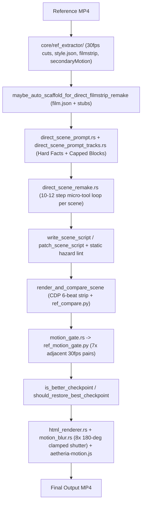

# AetheriaNexus — Motion Quality Technical Audit

- **Audited Commit / Branch:** `main` @ `6b7e3ae` (including preceding fixes `ef08869` → `597193d` → `6b7e3ae`)
- **Constraint Verified:** `.aetheria/AETHERIA.md` (lines 50–53) enforces modular HTML/JS (`index.html`, `script/scene1..N.js`, `window.AM`), deterministic `window.renderAt(t)` + `window.__ready = true`, headless Chrome/Edge CDP export, and zero Node/Remotion runtime dependencies. This audit respects that invariant and finds **no evidence that HTML5 Canvas 2D is the root cause of stiff motion**.

---

## 1. Executive Summary

AetheriaNexus already has a capable deterministic Canvas 2D runtime (`apps/public/script/aetheria-motion.js`, 46+ exports), rich 30fps reference extraction (`core/ref_extractor/`), 180° clamped sub-frame shutter motion blur (`core/aetheria-engine/src/studio/motion_blur.rs`), continuous side-by-side push transitions (`aetheria-motion.js`), and a per-render 30fps optical-flow motion gate (`core/aetheria-engine/src/studio/motion_gate.rs`).

Yet live remake outputs (Run 9, Run 11, Run 12) still feel stiffer and less intentional than After Effects references. Verification against actual source code, TypeScript-compiler AST audits of Run 9 & Run 12 scripts, and offline re-render experiments isolates **three proven fundamental root causes**:

1. **No validated pre-code Motion Specification (H1 — Confirmed, P0):** The direct remake compiler jumps directly from reference frames + compressed text facts to 200–380 lines of JS (`write_scene_script`). `// VISUAL PLAN:` is an unvalidated free-text comment. When the LLM polishes layout/colors in later steps, motion commitments silently drift (e.g., Run 12 S2 dropped `AM.drawTurntableObject`, S1 ignored parameter `t` in `drawSweepingRibbon(ctx, t)`, S3 rotated a star at `20°/s` vs `~99°/s` ref, S4 omitted `lineDashOffset`).
2. **Stale planning/coding coupling & easing monotony (H2/H6 — Partially Confirmed, P0/P1):** AST call analysis proves the LLM defaults to `AM.ease.outCubic` for **52.6% (Run 9)** and **55.6% (Run 12)** of all easing calls and fragments single moves across **47–55 `if (... t ...)` time branches**, while ignoring `outExpo`, `outQuart`, `inOutQuart`, and `AM.pop`/`AM.kick`/`AM.anticipation`.
3. **Coarse per-scene temporal QA without failure taxonomy (H4 — Confirmed, P1):** Visual SSIM/Edge scoring dominates early-exit and polish focus, while the 30fps motion gate evaluates only scene-aggregate `fastShare` and `p97Ratio` without detecting intra-scene velocity snaps (`if/else` boundary jumps) or classifying **Planning vs Implementation vs Extraction vs Renderer** failures.

---

## 2. Actual System Architecture & Data Flow (`HEAD 6b7e3ae`)

### Generation Paths Verified in Code

| Path | Entry Point | Trigger Condition | Role Structure | Used for Problematic Benchmark? |
|---|---|---|---|---|
| **Direct Per-Scene Remake** | `runner.rs:676-690` → `direct_scene_remake.rs` | `ToolProfile::Director`, `ref/extracted/style.json` + `filmstrip_index.json` (>=2 scenes), `stageMode != "hybrid"`, scaffold stubs present (or `AETHERIA_REMAKE_ONLY_SCENES`) | Single-model interactive micro-tool loop (up to 12 steps/scene, no subagents) | **YES** (Run 1 → Run 12 `benchmarks/pinterest-motion-remake/`). |
| **Standard / Multi-Subagent** | `runner.rs` → `subagent_store.rs:13-96` | Original creation (no video reference), single-scene projects, or explicit `AETHERIA_DIRECT_REMAKE=off` | Director (`default.txt`) delegates to `motion-designer`, `audio-director`, `qa-verifier` | Not used in Run 9–12 remake benchmark. |
| **Hybrid Stage** | `direct_scene_remake.rs:106-112` | `film.json` has `stageMode: "hybrid"` | Explicitly bypasses direct remake; handled by standard agent loop | No. |

> **Docstring discrepancy confirmed:** `direct_scene_remake.rs:1-17` still describes an obsolete "zero-tool 2-to-3-pass" loop, whereas the live implementation (`direct_scene_remake.rs:940-1760`, `direct_scene_tools.rs`) is an interactive 10–12 step micro-tool loop (`inspect_ref_frame`, `sample_ref_region`, `fetch_web_image`, `bash`, `read_filmstrip`, `write_scene_script`, `patch_scene_script`, `render_and_compare_scene`).

---

## 3. AST-Level API Audit (Run 9 vs Run 12 — TypeScript Compiler AST)

Using the TypeScript compiler AST parser (not regex/grep) on all 6 scripts from Run 9 (`benchmarks/pinterest-motion-remake/script/scene1..6.js`) and Run 12 (`scratch/live-verify-run12-out/script/scene1..6.js`):

| Metric / API Call | Run 9 (6 scripts) | Run 12 (6 scripts) | Finding |
|---|---:|---:|---|
| `AM.lerp` | `60` | `28` | Heavy linear interpolation |
| `AM.ease.outCubic` | `20` (52.6%) | `15` (55.6%) | Dominant default curve across both runs |
| `AM.ease.inOutCubic` / `inCubic` / `outBack` | `5 / 5 / 8` | `5 / 3 / 4` | Only 4 easing curves ever used |
| `AM.ease.outExpo` / `outQuart` / `inOutQuart` | `0` | `0` | Never selected despite being in prompt/API |
| `AM.spring` | `0` | `2` (S1, S6) | Improved from 0, still rare |
| `AM.pop` / `AM.kick` / `AM.anticipation` / `AM.drawMorphPolygon` | `0` | `0` | Unused in all 12 audited scripts |
| `AM.drawBlurRevealText` | `29` | `24` | High compliance because enforced by hazard |
| `AM.drawTurntableObject` | `5` (S2–S6; over-applied to flat S6) | `0` (S2 dropped back to flat `ctx.drawImage`) | Unstable without validated spec |
| `AM.applyCamera` / `AM.applyTrackedCamera` | `1 / 0` | `0 / 0` | Camera tracks rarely consumed |
| `if (... t ...)` time branches | `55` (S1:18, S2:15) | `47` (S3:12, S2:10, S6:10) | High phase-branching -> boundary jumps |
| `setLineDash` without `lineDashOffset` | `2` scenes (S4, S5) | `2` scenes (S3, S4) | Caused S4 dead-hold window (`1/26`) |
| Unused draw-helper `t` param | `0` | `1` (`S1 drawSweepingRibbon(t)`) | Frozen background ribbon |

> **Correction to initial audit note (Bukti F):** Literal grep counted `AM.drawTurntableObject` 8 times in Run 9 (including comments/fallbacks); AST call count is `5`, and 4 of those 5 calls were actually *misapplied* to flat 2D shapes before the `omega: 0` guard was added. Meanwhile `AM.drawBlurRevealText` achieved near-100% adoption specifically because it had a **hard static hazard** (`MISSING BLUR TEXT REVEAL HAZARD`). This proves **enforceable contracts beat prose prompt instructions**.

---

## 4. Benchmark Evidence Summary (Run 8 → Run 12 → Offline `6b7e3ae`)

| Run / Build | 36-Frame Overall | Edge | Dead Holds (`motion-feel`) | Seam POP | `fastSeconds` (Ref `6.61s`) | S3 / S5 `p97Ratio` | Notes |
|---|---:|---:|---:|---:|---:|---:|---|
| Run 8 | `0.7204` | `0.517` | `0/26` | `3/5` | — | — | S2 brain rolled back static |
| Run 9 | `0.6830` | `0.498` | `0/26` | `1/5` | — | — | S2 3D turntable best; S6 target warped |
| Run 11 | — | — | `0/26` | `3/5` | `2.20s` | `0.34 / 0.17` | Prompt 12 baseline |
| Run 12 (`109e3ce`) | **`0.7220`** | **`0.571`** | `1/26` (S4) | `3/5` | `2.07s` | `0.66 / 0.38` | S5 Step 9 bypassed motion gate (`cap=2` bug, fixed in `597193d`) |
| **Offline `6b7e3ae`** (Run 12 scripts, 0 LLM calls) | — | — | `1/26` (S4) | **`2/5`** | **`2.50s`** | **`0.79 / 0.64`** | Continuous push compositor + 180° clamped shutter fixed S2→S3 POP (`4.3×→2.5×`) & lifted all 6 `p97Ratio` |

---

## 5. Structured Findings (§10 Format)

### [F1] No Validated Motion Specification Between Reference Analysis and JS Coding (H1)
- **Severity:** P0 | **Confidence:** High | **Status:** Confirmed
- **Evidence:** `direct_scene_remake.rs:975-1495`, `direct_scene_tools.rs:68-187`, Run 12 `scene1.js:82`, `scene2.js:126`, `scene3.js:184`, `scene4.js:295`.
- **Observed behavior:** The model jumps directly from visual strips + prose facts to writing 300+ lines of Canvas JS. Motion intent exists only as unparsed `// VISUAL PLAN:` comments.
- **Why it matters:** During visual polish steps, the LLM frequently regresses motion (drops `drawTurntableObject`, freezes ribbons, slows spin rates by 5×) because nothing checks code against an explicit per-element motion contract.
- **Root cause:** Missing intermediate representation (`SceneMotionSpec`) + deterministic pre-code validator + spec-to-code compliance checker.
- **Alternative explanations:** Larger/stronger LLM models might adhere better without a spec, but Run 12 already ran on a frontier vision model and still broke 4 of 6 scenes' motion details.
- **Recommendation:** Add a compact, typed `write_motion_spec` tool (`motion_spec.rs`) validated deterministically before `write_scene_script`, gated behind a toggle (`AETHERIA_DIRECT_MOTION_SPEC=on|off`) for controlled A/B testing.
- **Trade-offs:** +1 fast tool step (~2–4s, ~600 tokens) per scene; zero extra subagents or model calls.
- **Validation:** Controlled A/B run on `ref_pinterest.mp4` (`AETHERIA_DIRECT_MOTION_SPEC=off` vs `on`) measuring compliance hazards, `fastShare`, `p97Ratio`, and human review score.
- **Acceptance criteria:** Zero spec-to-code regressions (`turntable_3d`, `rotate`, `blur_reveal`, `marching_dash`), >= 0.5× ref `fastShare`/`p97Ratio` on moving scenes without fidelity loss.

### [F2] Broken Two-Phase `cutSec` Push Compositor Caused Jump-Cuts & Blank Strips
- **Severity:** P0 | **Confidence:** High | **Status:** Confirmed (**FIXED in `6b7e3ae`**)
- **Evidence:** Former `aetheria-motion.js:716-781`; Run 12 `motion_feel_run12.json` (`@6.206s` POP `4.3×`); offline verify `6b7e3ae` (`@6.206s` POP dropped to `2.5×`, `S5 p97Ratio 0.38→0.64`).
- **Observed behavior:** Pre-`cutSec` slid `bufA` into an empty solid fill strip; post-`cutSec` snapped to `bufB` and clipped `bufA` into a hard vertical `ctx.rect` fading out.
- **Root cause:** Two-phase split heuristic overrides continuous side-by-side canvas panning whenever `totalDispPx > 0`.
- **Validation:** Verified offline via 537-frame re-render + Vitest offscreen buffer test + 2× E2E (`6b7e3ae`).

### [F3] Motion Gate Cap (`< 2`) & Asymmetric Rollback Allowed Motion Regressions to Win
- **Severity:** P0 | **Confidence:** High | **Status:** Confirmed (**FIXED in `597193d`**)
- **Evidence:** Former `direct_scene_tools.rs:955-957`, `direct_scene_remake.rs:714,734`, Run 12 S5 trace (Step 3 `fastShare=1.00/1.00, 0.8118` overwritten by unchecked Step 9 `fastShare=0.15, 0.8207`).
- **Root cause:** Unchecked renders defaulted to `motion_flow_deficit = false` (`hazards=0`) and `is_better_checkpoint` allowed `cand_hazards > best_hazards` for `+0.002` SSIM gain.
- **Validation:** Unit regression tests + 2× E2E (`597193d`).

### [F4] Temporal QA Lacks Velocity-Snap Detection & Failure Taxonomy (H4)
- **Severity:** P1 | **Confidence:** High | **Status:** Confirmed
- **Evidence:** `core/ref_extractor/ref_motion_gate.py:97-132`, `direct_scene_remake.rs:1343-1363`.
- **Observed behavior:** `ref_motion_gate.py` only flags low mean flow (`fastShare`/`p97Ratio < 0.5`). It cannot detect sudden mid-motion freeze/duplicate frames or `if/else` velocity snaps, and does not classify whether a failure is Planning, Implementation, Extraction, or Renderer.
- **Recommendation:** Extend `ref_motion_gate.py` & `motion_gate.rs` with velocity-continuity diagnostics (`abruptDropCount`, `duplicatePairCount`) and explicit `failureClass` (`implementation_motion_deficit`, `implementation_velocity_snap`, `extraction_low_confidence`, `none`).
- **Trade-offs:** Negligible (<5ms Python math on already-captured frames).
- **Validation:** Synthetic unit tests in `test_ref_motion_gate.py` (smooth motion vs mid-motion freeze/snap vs steady static ref).

### [F5] Easing Monotony (`outCubic` >52%) & Disconnected `if (t < A)` Phase Branches (H6)
- **Severity:** P1 | **Confidence:** High | **Status:** Confirmed (**Partially fixed in `6b7e3ae`**)
- **Evidence:** AST audit above (`outCubic` 20/38 in Run 9, 15/27 in Run 12; `47–55` time `if` branches).
- **Root cause:** `AM.ease` lacked explicit After Effects speed-graph curves (`aeGlide`, `aeSnap`, `outQuint`), and no pre-code spec required choosing easing per element role.
- **Recommendation:** Keep new AE curves (`6b7e3ae`) AND require `easing` per element in `SceneMotionSpec` with spec-to-code diversity check (warn only if a multi-element spec declared `aeGlide`/`spring`/`outExpo` and code collapsed all of them to `outCubic`).

### [F6] Extraction Prompt Caps (`900 / 950 / 700 / 950` chars) & Element Thresholds (H3)
- **Severity:** P2 | **Confidence:** Medium | **Status:** Partially confirmed
- **Evidence:** `direct_scene_prompt_tracks.rs:5,22,35,60,81,203,273`.
- **Observed behavior:** `elementTracks` filters at `disp >= 80px || ratio >= 1.4x`, max 6 points, max 3 tracks. However, M2 (`12cc07c`) already added dedicated 30fps `secondaryMotion` (`rotate`/`sweep`/`orbit`/`scale` without the 80px centroid filter) and foreground-only saturation ranking.
- **Root cause (remaining gap):** 6 points per track cannot capture subtle anticipation/overshoot inflection points on complex multi-phase moves; fixed char caps can silently truncate the last track with `...`.
- **Recommendation:** Do NOT blindly raise caps (risks prompt noise). Keep `secondaryMotion` + `elementFeel` (`overshootPct`/`settleSec`) separate, and only upgrade track sampling to key-inflection points (start, peak-vel, apex, settle, end) if A/B tests show extraction loss remains a bottleneck after P0 Motion Spec.

### [F7] Mode Conflation: Reference Remake Conservatism vs Original Creation (H5)
- **Severity:** P2 | **Confidence:** High | **Status:** Confirmed
- **Evidence:** `direct_scene_prompt.rs:34,47,52` ("NEVER invent extra elements", "keep ONLY measured moving elements alive") vs `subagent_store.rs:21-28` (Original Creation via `motion-designer` subagent).
- **Observed behavior:** Direct remake prompts are rightly conservative for faithful cloning, whereas original creation runs through `motion-designer` without any structured `SceneMotionSpec` or cross-scene rhythm guide.
- **Recommendation:** Explicitly tag `mode: "remake" | "original"` in `SceneMotionSpec` so remake validates against `style.json` reference evidence while original mode validates choreography hierarchy, timing overlap, and boundary continuity without suppressing creative motion.

### [F8] Stale Docstring in `direct_scene_remake.rs`
- **Severity:** P3 | **Confidence:** High | **Status:** Confirmed
- **Evidence:** `direct_scene_remake.rs:1-17`.
- **Recommendation:** Update module doc comment to reflect the actual interactive micro-tool + motion-spec + 30fps motion-gate architecture.

---

## 6. Hypothesis Verdict Table (H1–H6)

| Hypothesis | Verdict | Evidence Summary |
|---|---|---|
| **H1 (No validated Motion Spec)** | **Confirmed (P0)** | `// VISUAL PLAN:` is free-text; AST shows repeated motion regressions when polishing visuals. |
| **H2 (Insufficient role separation)** | **Partially Confirmed (P1)** | Zero-subagent flow itself is NOT the problem (multi-agent was slower & worse before); the missing separation is **phase separation** (Validated Plan → Code → Independent Temporal Gate) within one model. |
| **H3 (Extraction loses temporal detail)** | **Partially Confirmed (P2)** | Major 30fps secondary motion gap was already fixed in `12cc07c`; remaining gap is inflection-point sampling vs uniform 6 points. |
| **H4 (QA over-indexes visual SSIM vs motion)** | **Confirmed (P0/P1)** | Fixed cap/rollback bypass (`597193d`), still need velocity-snap detection + failure classification. |
| **H5 (Cross-scene rhythm & mode separation)** | **Confirmed (P2)** | `CrossContextMode::Off` by default; no explicit `remake` vs `original` motion spec mode; only 1 benchmark video. |
| **H6 (Runtime API discoverability/contracts)** | **Partially Confirmed (P1)** | Runtime already has 46+ helpers; issue is LLM defaulting to `outCubic` + `if/else` rather than missing low-level primitives. |

---

## 7. Explicit Answers to Section 11 Questions

1. **Three most likely evidence-backed root causes:** (a) No validated pre-code Motion Specification with spec-to-code checking (F1); (b) Previously broken cutSec push compositor + off-by-default shutter blur + motion-gate bypass (F2/F3 — now fixed in `597193d` & `6b7e3ae`); (c) Easing monotony (`>52% outCubic`) + coarse scene-aggregate QA lacking velocity-snap & failure classification (F4/F5).
2. **Where is the main problem?** A **combination** — primarily **Motion Planning + Code Compliance Enforcement + Temporal QA** (and until `6b7e3ae`, the transition compositor). NOT Canvas 2D or missing runtime primitives.
3. **Does Aetheria need a Motion Specification IR? Why?** **Yes, a lightweight per-scene JSON IR (`SceneMotionSpec`).** Because natural-language prompt rules fail silently during multi-step visual polishing, whereas a 20–40 line JSON spec lets Rust validate planning errors *before* coding and mechanically check code compliance *after* coding.
4. **Separate Motion Designer & Motion Engineer? Is one model enough?** **Separate the phase & output contract, NOT into expensive multi-agent loops.** One model executing `write_motion_spec` (planning contract) → Rust validator → `write_scene_script` (coding contract) → Python/Rust `motion_gate` (independent QA) achieves role separation at ~1 extra step cost.
5. **Can current benchmarks reliably detect stiff motion?** **Partially.** `motion-smooth-report.py` (`fastShare`, `p97Ratio`, `midMotionDup`) + `motion-feel-report.py` (`lag15`, `seam POP`) catch macro stiffness and dead holds reliably, but cannot judge subjective polish, single-element speed-graph shape, or blur aesthetics — human review remains mandatory.
6. **Hard gates vs diagnostics:**
   - *Hard gates:* 0 JS runtime errors, valid `SceneMotionSpec` schema/bounds, hard-cut 0-frame alignment, static motion hazards (`turntable_3d`, `blur_reveal`, `double-push`, unused `t`), 30fps optical-flow deficit (`< 0.50× ref` when ref moves), rollback protection for cleaner motion checkpoints.
   - *Diagnostics:* `p97Ratio` fine gradations, `energyRatio`, `abruptVelocityDrop`, easing diversity histogram, `midMotionDup` count, human review rubric.
7. **Smallest P0 change with highest impact:** Adding validated `write_motion_spec` (`motion_spec.rs`) + spec-to-code compliance lint + failure-classified `ref_motion_gate.py` (layered on top of `597193d` + `6b7e3ae`).
8. **What should NOT be built:** Do NOT migrate film runtime to Remotion/React; do NOT add GSAP/Three.js wrappers to chase "professional" labels; do NOT add 5-agent subagent committees; do NOT enforce mandatory spring/parallax/overshoot on every object; do NOT blindly raise prompt track character caps.
9. **How to prove improvement on >1 video type:** Add at least 2 distinct offline benchmark clips alongside `ref_pinterest.mp4` (typography/kinetic editorial + product UI/data-viz motion) and run the exact same A/B evaluation matrix (`AETHERIA_DIRECT_MOTION_SPEC=off` vs `on`) across all clips.
10. **Objective criteria for "professional-grade" motion graphics:** 0 runtime errors & deterministic seekability; >= 0.75 overall visual fidelity (36-frame) with >= 0.55 edge match; 0 unintended dead holds & 0 seam POPs > 3.0×; `fastShare` & `p97Ratio` >= 0.55× ref on dynamic scenes without over-animating steady holds; AND median >= 4/5 across all 7 dimensions of the Human Review Rubric on >= 2 distinct video styles.
