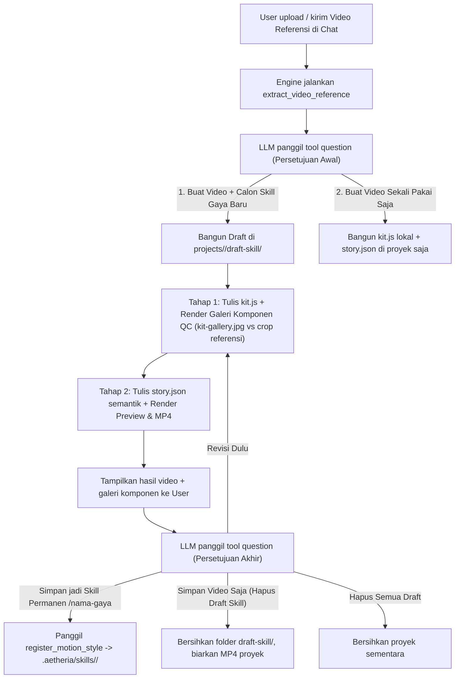

# Rencana Arsitektur: *Reference-to-Skill* & Pemangkasan Mesin Remake Lama

> Dokumen rencana kerja yang telah dicocokkan langsung dengan kode aktual di repositori (`commit 7866b36` + audit langsung `core/aetheria-engine/`, `core/ref_extractor/`, dan `apps/src/`).
> **Status:** Menunggu persetujuan owner sebelum eksekusi penghapusan dan perubahan kode.

---

## 1. Latar Belakang & Keputusan Arsitektur

Dari hasil pengujian nyata dan perbandingan langsung dengan repositori **`E:\stikman-cerita`** (`stikman-cerita`, `paperworld`, `voxelverse`):

1. **Mengapa `stikman-cerita` / `paperworld` / `voxelverse` menghasilkan kualitas studio?**
   Karena pemisahan tegas antara **Mesin Craft Gaya** (kode yang menggambar komponen spesifik gaya lengkap dengan proporsi, pencahayaan, outline, kamera semantik, dan aturan anti-tabrakan) dan **Sutradara JSON Semantik** (`proyek.json` / `story.json` — LLM hanya mengatur adegan, tokoh/komponen, timing, dan gerak kamera tanpa menulis koordinat pixel mentah).
2. **Mengapa mesin remake per-scene lama (`direct_scene_*`) & eksperimen `SceneSpec v2` low-level bermasalah?**
   - Jalur `direct_scene_*` menyuruh LLM menulis ~250–300 baris `ctx.*` mentah per scene (total **10.554 baris Rust** hanya untuk harness remake lama), menghasilkan duplikasi kode tinggi, inkonsistensi antar-scene, dan beban pemeliharaan besar.
   - Eksperimen `SceneSpec v2` low-level (primitif `shape`/`text`/koordinat mentah di JSON) terbukti gagal secara visual karena membatasi LLM tanpa memberi *visual craft* tingkat tinggi.
3. **Solusi Baru — *Reference-to-Skill* Berbasis Persetujuan User:**
   Saat user mengunggah video referensi, LLM **membangun paket Skill Deklaratif baru** (`kit.js` + `kit.json` + `SKILL.md` + `story.json`) di folder draft proyek terlebih dahulu, memverifikasi setiap komponennya lewat **Galeri Komponen QC** + preview video, lalu **meminta persetujuan user** apakah ingin menyimpannya permanen sebagai skill `/<nama-gaya>`, menyimpan videonya saja, atau menghapus draft-nya.

---

## 2. Audit & Pemangkasan Mesin Referensi Lama (~10.500+ Baris Dihapus)

### 2.1 Modul Rust & Eksperimen yang Dihapus Total

Seluruh loop pembajak turn `direct_scene_remake` di `runner.rs` (baris 678–699) dilepas, dan **11 modul Rust** berikut dihapus agar engine kembali ramping:

| File yang Dihapus | Baris | Alasan Penghapusan |
|---|---:|---|
| `core/aetheria-engine/src/session/agent_turn/direct_scene_remake.rs` | 3.378 | Loop monolog kode `ctx.*` per-scene warisan yang membajak turn utama |
| `core/aetheria-engine/src/session/agent_turn/direct_scene_prompt.rs` | 1.880 | System prompt khusus penulisan `sceneK.js` mentah |
| `core/aetheria-engine/src/session/agent_turn/direct_scene_tools.rs` | 1.403 | Micro-tools khusus `write_scene_script` / `patch_scene_script` |
| `core/aetheria-engine/src/session/agent_turn/motion_spec.rs` | 788 | Validator pra-kode khusus loop `direct_scene_remake` |
| `core/aetheria-engine/src/session/agent_turn/scene_auditor.rs` | 649 | Auditor khusus loop `direct_scene_remake` |
| `core/aetheria-engine/src/session/agent_turn/direct_scene_switches.rs` | 614 | Belasan env switch eksperimen loop lama |
| `core/aetheria-engine/src/session/agent_turn/direct_scene_prompt_tracks.rs` | 542 | Formatter track khusus prompt `direct_scene` |
| `core/aetheria-engine/src/session/agent_turn/direct_scene_trace.rs` | 452 | Tracer khusus loop `direct_scene` |
| `core/aetheria-engine/src/session/agent_turn/scene_spec.rs` *(untracked N2)* | 644 | Eksperimen `SceneSpec v2` low-level yang ditolak |
| `core/aetheria-engine/src/session/agent_turn/direct_scene_spec_tools.rs` *(untracked N2)* | 146 | Eksperimen tool `SceneSpec v2` low-level |
| `core/aetheria-engine/src/session/agent_turn/direct_scene_prompt_spec.rs` *(untracked N4)* | 58 | Eksperimen prompt `SceneSpec v2` low-level |
| **Total Rust Dihapus** | **10.554** | **Penyusutan masif kompleksitas `aetheria-engine`** |

File eksperimen/skrip warisan di luar Rust yang ikut dibersihkan:
- Eksperimen lokal N1–N3 yang belum di-commit: `apps/public/script/aetheria-scene-spec.js`, `apps/src/lib/sceneSpec.test.ts`, `apps/src/lib/fixtures/sceneSpecV2Fixtures.json`, `core/ref_extractor/ref_spec_seed.py`, `core/ref_extractor/test_ref_spec_seed.py`, serta revert sambungan tipisnya di `aetheria-motion.js`, `AM_API.md`, `builtin_runtime.rs`, `film_static_server.rs`, `film_scaffold.rs`.
- Skrip benchmark/harness khusus loop lama: `scripts/test-single-scene-loop.mjs`, `scripts/run-remake-ablation.mjs`, `scripts/test-smart-scene-harness-e2e.mjs`.

### 2.2 Alat Forensik Referensi yang DIPERTAHANKAN (Mata LLM untuk Membuat Skill)

Alat ekstraksi referensi berikut **tetap dipertahankan** karena dibutuhkan koordinator/subagent untuk membedah video referensi (palet warna, tipografi, cuts, kamera, dan crop komponen asli) saat merancang `kit.js` baru:

| Komponen yang Dipertahankan | Peran dalam Alur *Reference-to-Skill* |
|---|---|
| `tool/ref_extractor.rs` (`extract_video_reference`) + `core/ref_extractor/ref_extractor.py` | Mengekstrak cuts adegan, palet warna, OCR tipografi, clean plate, dan gerak kamera dari video referensi |
| `tool/ref_filmstrip.rs` (`read_filmstrip`) | Membaca contact-sheet perjalanan visual tiap adegan referensi secara hemat token |
| `tool/ref_probe.rs` (`inspect_ref_frame`, `sample_ref_region`) | Mengambil crop tajam objek/elemen referensi sebagai acuan visual saat memoles komponen di `kit.js` |
| `tool/film_feedback.rs` (`capture_film_preview`) & `core/ref_extractor/ref_compare.py` | QC visual 3-frame per shot (`contact_sheet.jpg`) dan galeri komponen sebelum hasil dikirim ke user |

---

## 3. Audit & Perombakan Alur `Add Skill` (`styles.rs`, `catalog.rs`, `AddSkillModal.tsx`)

### 3.1 Temuan Masalah di Kode Saat Ini

Hasil baca kode `core/aetheria-engine/src/studio/styles.rs`, `core/aetheria-engine/src/tool/catalog.rs`, dan `apps/src/components/workstation/chat/presets/AddSkillModal.tsx` menemukan **4 celah nyata**:

1. **Warisan Remotion usang di `styles.rs:66–190`:** Mode registrasi klasik masih membangkitkan `REMOTION_BRIEF.md`, `style.md`, `tokens.json`, dan rumus `Scale Law: u(refPx) = refPx * (1080 / 410)` yang tidak relevan dengan mesin `StoryCore` / HTML5 deklaratif saat ini.
2. **Definisi tool `register_motion_style` di `catalog.rs:98–123` tidak sinkron dengan `tool/mod.rs:322`:** Handler di `mod.rs` sudah mendukung parameter `files` (paket multi-file `SKILL.md` + `examples/kit.json` + `examples/script/*.js`) dan import direktori lokal, tetapi `catalog.rs` masih mewajibkan `"required": ["name", "file_path"]` untuk satu file `.md` saja — sehingga LLM tidak tahu cara mendaftarkan paket skill deklaratif dari draft proyek!
3. **Belum ada fitur Hapus Skill (`delete_motion_style` / `DELETE /api/skills/:id`) & proteksi skill bawaan:** Semua 19 skill bawaan (`mg-*`) dan skill buatan user berada di `.aetheria/skills/` tanpa metadata pembeda (`builtin` vs `user-created`), sehingga belum ada mekanisme aman bagi user/LLM untuk menghapus skill kustom tanpa risiko menyentuh skill bawaan.
4. **UI `AddSkillModal.tsx` terlalu sempit:** Hanya menerima input teks path file `.md` manual, memakai variabel CSS `--accent-primary` yang tidak terdefinisi di `apps/src/index.css`, belum mendukung import folder paket skill deklaratif, belum punya pintasan *"Buat Skill dari Video Referensi"*, dan belum menampilkan daftar skill kustom untuk dihapus.

### 3.2 Desain Baru Manajemen Skill

1. **Penanda Asal Skill (`skill-meta.json`) & Proteksi Built-in:**
   - Setiap skill yang didaftarkan oleh user atau dipromosikan dari video referensi otomatis memiliki `.aetheria/skills/<slug>/skill-meta.json`:
     ```json
     {
       "origin": "reference",
       "createdAt": "2026-11-26T15:00:00Z",
       "sourceVideo": "ref_pinterest.mp4",
       "deletable": true
     }
     ```
   - Ke-19 skill bawaan repo tidak memiliki `deletable: true` (otomatis terdeteksi `builtin: true`, `deletable: false`). Engine menolak keras penghapusan skill `builtin`.
2. **Backend Endpoints & Agent Tools Lengkap:**
   - Perbarui `register_motion_style` (`POST /api/skills/add`):
     - Mendukung promosi langsung dari **folder draft proyek** (`draft_dir`, mis. `projects/<proyek>/draft-skill/`) atau `files[]` ke `.aetheria/skills/<slug>/`, dengan validasi wajib: memiliki `SKILL.md`, `examples/kit.json`, `examples/script/*.js`, dan `examples/story.example.json` (bebas dari artefak `REMOTION_BRIEF.md` lama).
   - Tambah `delete_motion_style` (`DELETE /api/skills/:id`):
     - Menghapus `.aetheria/skills/<slug>/` hanya bila `deletable == true` (mengembalikan HTTP 403 / pesan error jelas jika mencoba menghapus skill bawaan).
   - Perbarui `GET /api/skills`: mengembalikan `builtin: boolean`, `origin: string`, dan `deletable: boolean` agar UI bisa merender badge dan tombol hapus dengan akurat.
3. **Pembaruan UI `AddSkillModal.tsx` (Sederhana, Bulat Seragam, Sesuai Tema `index.css`):**
   - **Tab 1 — Buat dari Video Referensi:** Pilih/lampirkan video `.mp4` + nama gaya opsional → otomatis mengirim instruksi ke sesi Chat aktif untuk memulai alur *Reference-to-Skill*.
   - **Tab 2 — Import Paket Skill:** Import dari folder paket skill deklaratif lokal (seperti `paperworld` / `stikman-cerita`) atau file `SKILL.md`.
   - **Tab 3 — Kelola Skill Saya:** Menampilkan daftar skill di `.aetheria/skills/` dengan badge `Built-in` (terkunci) vs `Custom / Reference` (dilengkapi tombol **Hapus** 1-klik + konfirmasi).

---

## 4. Alur *Reference-to-Skill* End-to-End dengan Persetujuan User



### Standar Kualitas Paket Skill yang Dihasilkan LLM (Mengikuti Pola `stikman-cerita`)

Agar hasil video referensi **setajam `E:\stikman-cerita`** dan tidak jatuh seperti `SceneSpec v2` low-level:

1. **Anatomi Paket Wajib (Sama dengan `mg-stickman-story`):**
   - `SKILL.md` — panduan gaya, daftar komponen semantik, palet, tipografi, dan aturan kamera.
   - `examples/kit.json` — deklarasi daftar script runtime (`story-core.js`, `story-camera.js`, `<slug>-kit.js`).
   - `examples/script/<slug>-kit.js` — **Mesin Craft Gaya** yang mendaftarkan latar, komponen visual tingkat tinggi (mis. `editorialCard`, `kineticHeadline`, `turntableBadge`, `milestoneCounter`, `concaveStar`), dan palet warna terukur dari referensi.
   - `examples/story.example.json` — contoh JSON sutradara pendek yang bersih (tanpa koordinat pixel mentah atau kode `ctx.*`).
   - `assets/kit-gallery.jpg` — lembar bukti visual setiap komponen yang sudah lulus QC.
2. **Gerbang Wajib *Component Gallery QC* sebelum Menyusun Adegan:**
   - LLM dilarang langsung merender video panjang sebelum merender lembar galeri komponen (`kit-gallery.jpg`), membukanya, dan membandingkannya dengan crop asli dari `sample_ref_region` / `read_filmstrip`.
3. **Persetujuan Eksplisit User via Tool `question`:**
   - LLM **dilarang keras** memanggil `register_motion_style` (menulis ke `.aetheria/skills/`) tanpa jawaban persetujuan eksplisit user setelah user melihat hasil preview/MP4.

---

## 5. Rencana Eksekusi Bertahap & Verifikasi (`Langkah -> Verifikasi`)

### Tahap 1 — Bersihkan Eksperimen N1–N4 & Pangkas 10.554 Baris Mesin `direct_scene_*`
- **Langkah:** Revert file lokal N1–N4 yang ditolak, hapus 8 modul `direct_scene_*` / `motion_spec` / `scene_auditor` lama beserta 3 skrip E2E warisannya, dan lepaskan kaitannya di `runner.rs` & `mod.rs` (tetap pertahankan `extract_video_reference`, `read_filmstrip`, `inspect_ref_frame`, `sample_ref_region`, dan `remake-authoring-report.py`).
- **Verifikasi:** `cargo test --workspace`, `npm run typecheck`, `npm run build`, dan `(cd apps && npx vitest run)` lulus 100% tanpa kode mati atau warning baru.

### Tahap 2 — Perbarui Backend Skill Manager (`styles.rs`, `catalog.rs`, `delete_motion_style`)
- **Langkah:**
  1. Bersihkan generator `REMOTION_BRIEF.md` usang di `styles.rs`, tambahkan metadata `skill-meta.json` (`origin`, `deletable`), dan dukung promosi folder draft (`draft_dir`) di `register_motion_style`.
  2. Tambahkan endpoint `DELETE /api/skills/:id` + tool `delete_motion_style` dengan proteksi ketat: menolak penghapusan 19 skill bawaan (`builtin: true`).
  3. Perbarui skema `register_motion_style` & `delete_motion_style` di `catalog.rs` dan allowlist `profiles.rs`.
- **Verifikasi:** Unit test Rust untuk registrasi paket deklaratif, penolakan hapus skill `builtin` (HTTP 403 / error jelas), dan penghapusan bersih skill `custom`/`reference`.

### Tahap 3 — Alur Prompt *Reference-to-Skill* (2 Titik `question` + Gallery QC) & UI `AddSkillModal.tsx`
- **Langkah:**
  1. Perbarui panduan referensi di `default.txt` / `dynamic_context.rs` agar saat ada lampiran/path video referensi, koordinator menjalankan alur *Reference-to-Skill* (tanya via `question` → bangun draft `kit.js` + `kit-gallery.jpg` QC + `story.json` → tampilkan hasil → tanya persetujuan simpan/hapus via `question`).
  2. Perbarui `AddSkillModal.tsx` menjadi dialog 3-tab bulat rapi sesuai variabel `apps/src/index.css` (*Buat dari Referensi*, *Import Paket Skill*, *Kelola/Hapus Skill Kustom*).
- **Verifikasi Statis & Unit:** `npm run typecheck`, `npm run build`, `(cd apps && npx vitest run)`, `cargo test --workspace`, `npm run build:engine`.

### Tahap 4 — Verifikasi E2E Wajib (`AGENTS.md §3.3`)
1. **E2E API & Proteksi Skill (`scripts/test-reference-to-skill-e2e.mjs`):**
   - Jalur sukses: promosi folder draft skill deklaratif → muncul di `GET /api/skills` (`deletable: true`) → bisa diaktifkan `/<slug>` → dihapus bersih lewat `DELETE /api/skills/:id`.
   - Jalur gagal: mencoba menghapus `mg-stickman-story` (`builtin`) → ditolak bersih tanpa menghapus file apa pun; mencoba mendaftarkan paket rusak tanpa `SKILL.md` → ditolak dengan pesan jelas.
2. **E2E UI Playwright (`e2e/skill-manager-modal.spec.ts`):**
   - Buka modal `/add skill`, uji ketiga tab, hapus skill kustom uji di `os.tmpdir()`, dan verifikasi visual di ketiga tema (`dark`, `light`, `neobrutalism`) 2× berturut-turut.
3. **E2E Sesi Live 9Router (`ComboMaut`):**
   - Upload video referensi di sesi aktif → verifikasi munculnya `question` persetujuan → bangun `kit.js` + `kit-gallery.jpg` + `story.json` + MP4 → uji simpan jadi skill baru & uji hapus skill tersebut.
